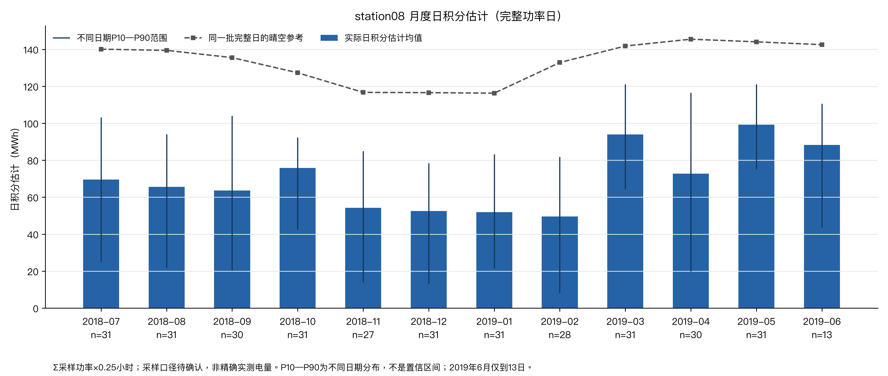
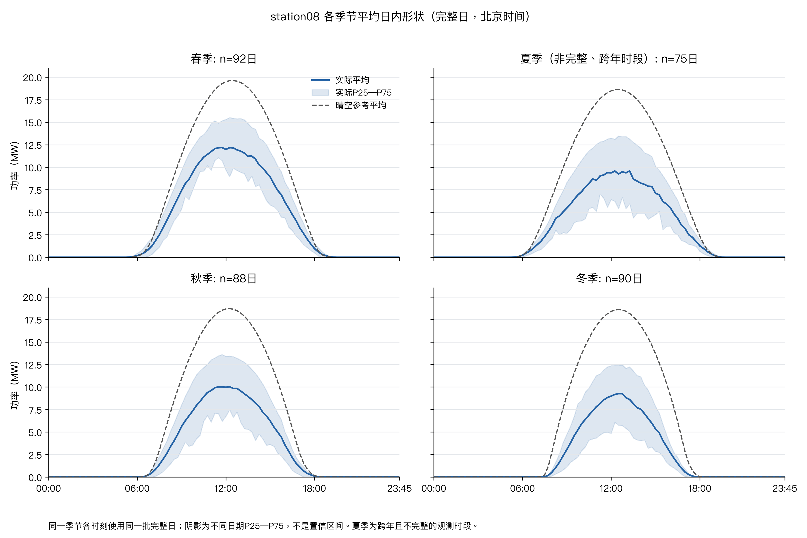
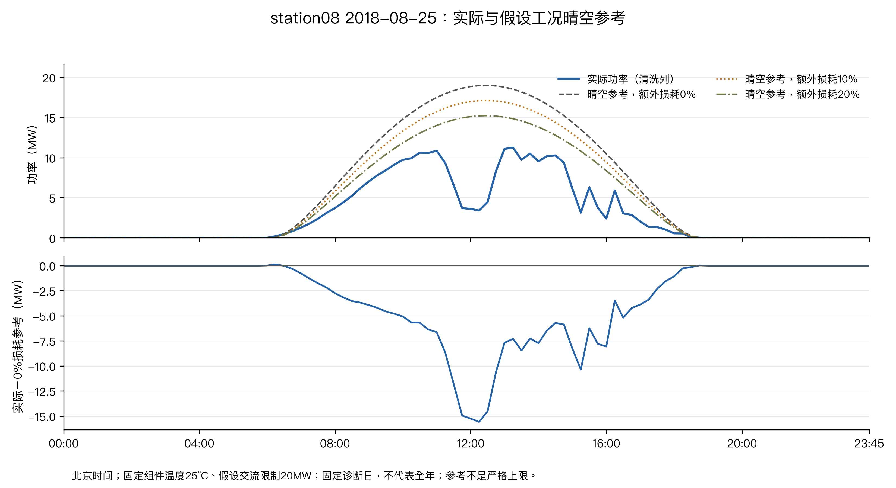
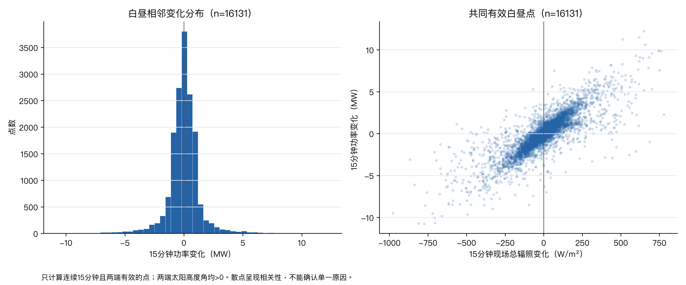
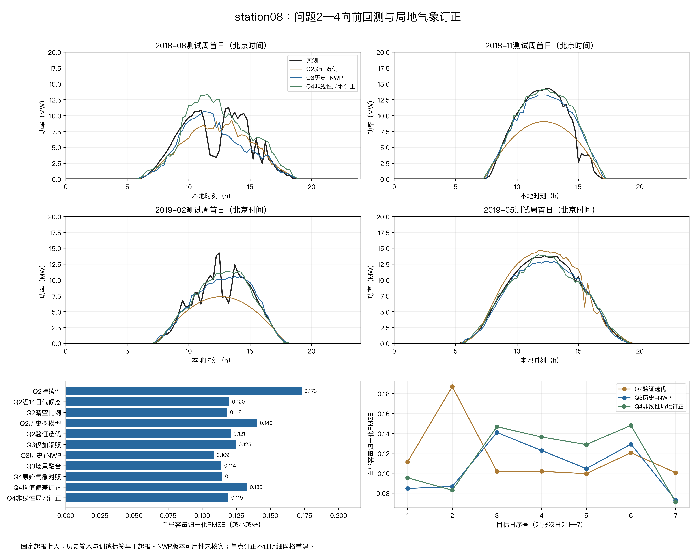

# 光伏电站出力特性与融合气象信息的功率预测

摘要

光伏出力既有由太阳位置决定的日周期，也受天气变化影响。本文选取 PVOD 数据集中的 station08 电站，利用 15 分钟功率、现场气象和数值天气预报（NWP）数据，分析出力特性，比较历史功率预测、气象信息融合与局地统计订正的效果。样本覆盖 2018 年 7 月至 2019 年 6 月的 345 个完整观测日，未满一年。主实验在四个指定月末周固定起报，预测未来七天，训练标签与历史功率输入均早于起报时刻。

针对问题一，建立晴空辐照、板面转换与逆变器相结合的参考功率模型。月度日积分估计均值在 2019 年 5 月最高，为 99.23 MWh，2 月最低，为 49.56 MWh；白昼实际功率较参考平均低 5.34 MW。相邻 15 分钟功率变化绝对值的 95 分位为 2.798 MW，其变化与现场辐照变化的相关系数为 0.843。

针对问题二，比较持续性、近 14 日同时刻均值、晴空比例和残差梯度提升树，以起报前独立验证周选定主方案。四周 1346 个白昼点的容量归一化均方根误差（nRMSE）为 0.1210；固定晴空比例基线为 0.1184，表明复杂模型与验证选优均不必然优于简单基线。

针对问题三，在目标时刻 NWP 于起报时可用的假设下，加入气象字段后 nRMSE 降至 0.1086，相对第二问主方案下降 10.28%。中、高预报辐照档改善，唯一低辐照测试日退化。按日期分层重抽所得误差差的 95% 区间跨零，尚不足以确认稳定收益。

针对问题四，采用辐照、气温订正与功率映射组成的两阶段模型。非线性局地订正 nRMSE 为 0.1193，较同一功率映射的原始气象对照上升 3.94%，未取得总体改善。由于原始 NWP 空间尺度及站点提取关系缺失，本实验仅验证单站订正，未验证空间分辨率提升。

结果说明，气象信息在固定测试样本上有预测价值，但需结合场景和日期差异评价。七天固定起报的总体结果不能全部解释为 24—48 小时日前精度；实际应用仍需补齐预报发行信息并开展逐日回测。

关键词：光伏功率预测；晴空参考模型；梯度提升树；数值天气预报；局地统计订正

## 一、问题重述

### 1.1 问题背景

光伏发电出力受太阳辐照、云量、气温等天气条件影响，具有明显的随机性与间歇性。电网在安排次日供电计划时，需要提前掌握光伏电站的出力水平。若预测偏高，会因预留备用容量不足而影响供电安全；若预测偏低，则会增加常规机组备用、抬高运行成本。因此，提高光伏功率日前预测精度具有直接的工程价值。

随着数值天气预报（NWP）的发展，将预报的辐照、气温等气象要素纳入预测模型已成为主流思路。与此同时，光伏电站的出力还受到局地云场、地形与设备状态的影响，而 NWP 本身存在空间分辨率不足的问题。本题围绕上述背景，给出某光伏电站的实测功率、现场气象与 NWP 预报数据，要求建立预测模型并检验气象信息的价值。

本次建模采用 PVOD v1.0 公开数据集[1][2][3]。该数据集包含多个光伏电站的多源功率输出数据，本文选取 station08 电站作为主站，station01 仅用于问题一的质量对照。

### 1.2 问题重述

根据题目与附件 1（误差分析方法）[4]的要求，需要完成以下四项工作：

问题一：分析光伏电站出力的变化特性。要求对实测数据进行质量检查与必要处理，刻画功率的日周期、月度与季节变化以及短时波动特征，并可与参考水平作对比。

问题二：在不使用现场逐时气象和 NWP 预报字段、以历史功率为主要输入的条件下，建立次日功率预测模型。要求给出可解释的基线方法与回归模型，并按规定的测试集评价。

问题三：在问题二的基础上加入 NWP 气象信息，验证气象信息带来的增益，并分析在不同天气（辐照）条件下模型的适用性。

问题四：处理 NWP 的空间尺度问题，检验将粗分辨率气象信息映射到电站局地尺度的效果。

题目规定：测试集为第 2、5、8、11 月的最后一周，即 2018-08-25—08-31、2018-11-24—11-30、2019-02-22—02-28、2019-05-25—05-31（北京时间），每周 672 点，共 2688 点。误差分析须按附件 1 的定义执行，功率以装机（开机）容量归一化。


## 二、问题分析

### 2.1 问题一的分析

问题一的目标是认识数据本身：数据是否可靠、出力的时间规律如何、以及在给定天气条件下实际出力与理论水平的差距有多大。

已有条件是 15 分钟分辨率的实测功率与现场气象。需要达到的目标是：给出可信的清洗结论、量化日与季节的出力形态、并建立一个可解释的参考基准。所选数学方法为"数据质量核查 + 确定性物理参考模型 + 描述性统计分析"。工作流程为：先核查时间网格与数值合法性，再做清洗，随后用晴空辐照与板面转换模型建立参考功率，最后从月度、季节、短时波动与参数敏感性几个角度刻画特性。需要强调，参考功率用于解释差异，不是预测，也不是严格上限。

### 2.2 问题二的分析

问题二在不使用现场逐时气象和 NWP 预报字段的条件下预测次日功率，其实质是检验"仅凭功率自身的历史规律能做到什么程度"。

由于光伏出力具有强日周期，且晴空条件下的出力近似只由太阳几何决定，因此合适的思路是先建立简单、可解释的基线：持续性（最近一个完整日同时刻）、气候态（近 14 日同时刻均值）、晴空比例（以晴空参考为骨架、用历史功率标定比例系数）。在此基础上，再用梯度提升树学习相对物理基线的残差，以捕捉历史状态与季节的剩余规律。评价采用相对容量的归一化误差，并严格遵守时间因果：预测第 D 日时，训练与历史输入均早于起报时刻。

### 2.3 问题三的分析

问题三在问题二的基础上加入 NWP 预报的辐照、气温、湿度、风速、压力等要素。核心问题是：气象信息是否真的带来增益，以及在什么条件下有效。

合适的思路是在相同历史特征与残差目标上增加 NWP 字段，得到第三问模型；再通过"辐照消融"（只保留辐照类字段）判断非辐照信息是否有额外贡献；进一步按预报晴空指数把样本分为低、中、高三档辐照场景，检验分场景表现，并允许场景融合在必要时不启用 NWP。评价同样只在白昼点上进行，并另做按日期的重抽检验以判断改善是否稳定。

### 2.4 问题四的分析

问题四关注 NWP 的空间尺度问题：粗分辨率网格气象如何映射到电站所在的局地尺度。

当前数据只提供单站 NWP 与现场测量，未说明原始网格尺度及站点提取关系，无法验证分辨率提升。本文采用"模式尺度预报量→电站测点气象"的单点统计降尺度，即对辐照和气温做回归订正。因此本文的分析策略是：在单点意义上检验"气象订正是否改善功率回测"，并与原始气象对照、均值偏差订正及问题三强基线比较，从而给出有边界的结论。


## 三、模型假设

1. 在数据质量核查与异常标记之后，保留观测用于刻画样本期运行状态；未记录的停机、限电等因素不作独立识别。
2. 功率采样按 15 分钟计，时间戳视为采样时刻进行点值对齐；采样为瞬时值或区间均值尚未确认（见第十节与结论的边界说明）。
3. 题目未提供随时间变化的开机容量记录，故以装机容量 20 MW 作为开机容量，用作误差归一化的容量基准 C。
4. 电站直流组件额定容量按元数据计算，即 78042 块 × 265 Wp = 20.68113 MWp；交流限制暂设为 20 MW。两者分别定义，均未经独立核实。
5. 参考模型的物理参数作如下假设：海拔 0 m（另设 200 m 作敏感性）、地面反照率 0.25、组件温度固定 25 ℃、逆变器额定效率 0.96。组件数量、规格及朝南 33° 倾角来自元数据，其余为参考模型的工作假设。
6. NWP 字段在每次起报时刻均可获得（"可用性假设"）。原始数据未提供发行时刻、预报版本与提前量，因此该假设未获证实，第三、四问的结论均限于此假设下的条件回测。
7. 测试周为四个自然月最后 7 日；白昼定义为几何太阳高度角大于 0°，不依据实际功率判定。
8. 向前实验中，训练标签与历史输入均严格早于起报时刻；七天目标日共用起报时的历史信息，不进行真值递推。


## 四、符号说明

表 1 主要符号与单位

| 符号 | 含义 | 单位 |
| --- | --- | --- |
| $P_i$ | 第 $i$ 个白昼点的实测功率 | MW |
| $\widehat P_i$ | 对应的预测功率 | MW |
| $C$ | 误差归一化容量（取 20 MW，装机容量代替开机容量） | MW |
| $e_i$ | 归一化误差，$e_i=(\widehat P_i-P_i)/C$（正表示预测偏高） | 无量纲 |
| $E_{rmse}$ | 归一化均方根误差 | 无量纲 |
| $E_{mae}$ | 归一化平均绝对误差 | 无量纲 |
| $E_{me}$ | 归一化平均误差（偏差） | 无量纲 |
| $r$ | 实测与预测的 Pearson 相关系数 | 无量纲 |
| $C_R$ | 准确率，$C_R=(1-E_{rmse})\times100\%$ | % |
| $Q_R$ | 合格率，$|e_i|<0.25$ 的样本比例 | % |
| $G_{poa}$ | 板面（倾斜面）总辐照 | W/m² |
| $G_{cs}$ | 晴空辐照 | W/m² |
| $P_{cs}$ | 晴空参考功率 | MW |
| $a$ | 晴空比例系数（过原点最小二乘标定） | 无量纲 |
| $x_{o,t}$ | 起报时刻 $o$ 下目标时刻 $t$ 的特征向量 | — |
| $f_2,\ f_3$ | 问题二、问题三的残差梯度提升树 | — |
| $k_d$ | 预报晴空指数，即目标日白昼 $G_{NWP}/G_{cs}$ 的均值 | 无量纲 |
| $w_s$ | 场景 $s$ 下第三问模型的融合权重 | 无量纲 |
| $D_G,\ D_T$ | 辐照、气温的局地统计订正映射 | — |
| $F$ | 由真实局地气象到功率的映射 | — |

误差指标定义如下（$n$ 为参与评价的白昼样本数）：

$$E_{rmse}=\sqrt{\frac{1}{n}\sum_{i=1}^{n}e_i^2},\qquad E_{mae}=\frac{1}{n}\sum_{i=1}^{n}|e_i|,\qquad E_{me}=\frac{1}{n}\sum_{i=1}^{n}e_i,$$

$$C_R=(1-E_{rmse})\times100\%,\qquad Q_R=\frac{1}{n}\sum_{i=1}^{n}\mathbf 1(|e_i|<0.25)\times100\%.$$

其中 $E_{rmse}$ 与 $E_{mae}$ 为归一化（无量纲）误差，$C_R$、$Q_R$ 以百分数报告。$E_{rmse}$ 值 0.1086 对应约 10.86% 的容量归一化均方根误差。


## 五、问题一的模型建立与求解

### 5.1 数据来源与预处理

主站数据取自 `data/PVOD/station08.csv` 与 `metadata.csv`。时间按 UTC 读取并转换为北京时间，覆盖 2018-07-01 00:00 至 2019-06-13 23:45，共 33120 条 15 分钟记录。按题目要求，参赛数据集的关键信息以表格形式呈现如下。

表 2 光伏电站及数据规格

| 数据规格 | 参数值 |
| --- | --- |
| 数据来源（公开数据集链接） | PVOD v1.0（Multi-source photovoltaic power output dataset with Python toolkit），Science Data Bank，2021，DOI:10.11922/sciencedb.01094；本项目使用其解压文件，主站文件为 `data/PVOD/station08.csv`，附带 `metadata.csv` |
| 光伏电站装机容量 | 元数据容量 20000 kW，即 20 MW（作为开机/评分归一化容量的假设）。直流组件额定容量按 78042 块 × 265 Wp = 20.68113 MWp 计算；交流限制亦暂设 20 MW。二者分别表述，均未经独立核实 |
| 发电功率和 NWP 数据时间分辨率 | 1 采样点 / 15 min |
| 发电功率和 NWP 数据起始—截至时间 | 2018.07.01—2019.06.13（北京时间 2018-07-01 00:00 至 2019-06-13 23:45；UTC 2018-06-30 16:00 至 2019-06-13 15:45），不足完整一年 |
| NWP 属性 | 全球辐照、直射辐照、气温、湿度、风速、风向、气压（对应 `nwp_*` 列）；现场气象另有 `lmd_*` 列（总辐照、散射辐照、气温、气压、风向、风速）。原始数据未提供 NWP 发行时刻、预报版本与提前量 |
| 站点信息 | 主站 station08：东经 113.89999°、北纬 36.70761°，组件朝南倾角 33°；海拔未提供（暂设 0 m，另设 200 m 作敏感性）。对照站 station01：东经 117.45722°、北纬 38.18306°，朝南 33°，74000 块 × 270 Wp = 19.98 MWp |

核查结果：无重复时间戳、无字段缺失与基础非法值；时间网格缺失 288 点，全部位于 2018-11-11 至 2018-11-13 三个整日，缺失日期不补零、不插值。共有 345 个完整观测日（每日 96 点功率完整），观测跨度为 348 个日历日，未达到题目要求的完整一年；缺测与未覆盖时段均未用其他站点数据拼接。

清洗沿用 station01 的阈值与规则：仅当功率与六项现场气象连续至少 4 点完全相同，且段内至少一个点同时满足太阳高度角低于 −6°、功率大于 0.01 MW、现场总辐照大于 0 时，才将后续重复值置为缺失。本次 station08 未发现可疑持值段，修改字段值 0 个。白昼强辐照下的零/低功率 28 点、近地平线夜间正功率 9 点予以保留并标记。需要说明：未发现异常不等于所有物理口径都已核实。

### 5.2 晴空参考功率模型

为刻画晴空条件下的参考出力形态，采用 pvlib 实现物理计算链[5][6]。计算链为：太阳位置 → Ineichen 晴空辐照 → 各向同性板面辐照转换 → 固定 25 ℃ 组件直流功率 → PVWatts 逆变器交流输出。直流参考功率为

$$P_{dc,ref}(t)=20.68113\times\frac{G_{poa}(t)}{1000}\times(1-L)\quad(\mathrm{MW}),$$

其中 $L$ 为额外损耗比例，逆变器直流输入限制取 $20/0.96$ MW，额外损耗与逆变器损耗分别计算。夜间参考设为 0，实测值不作修改。模型参数取自元数据与工作假设（见第三节），未通过实测功率拟合。

必须强调：该参考曲线是简化物理工况下的估计，不是任何天气下都成立的严格发电上限，也不是日前功率预测，因此其后与实测的偏差不能称为预测误差。

### 5.3 月度与日内特性分析

日积分估计为每个完整日的 96 个采样功率之和乘以 0.25 h。由于功率是瞬时值还是区间均值尚未确认，故仅称"积分估计"，不宣称精确实测电量。

表 3 月度日积分估计

| 月份 | 观测日 | 完整功率日 | 日积分估计均值(MWh) | 同日参考均值(MWh) |
| --- | --- | --- | --- | --- |
| 2018-07 | 31 | 31 | 69.562 | 140.088 |
| 2018-08 | 31 | 31 | 65.618 | 139.457 |
| 2018-09 | 30 | 30 | 63.617 | 135.540 |
| 2018-10 | 31 | 31 | 75.777 | 127.330 |
| 2018-11 | 27 | 27 | 54.216 | 116.723 |
| 2018-12 | 31 | 31 | 52.465 | 116.570 |
| 2019-01 | 31 | 31 | 51.943 | 116.292 |
| 2019-02 | 28 | 28 | 49.560 | 132.864 |
| 2019-03 | 31 | 31 | 93.896 | 141.805 |
| 2019-04 | 30 | 30 | 72.725 | 145.501 |
| 2019-05 | 31 | 31 | 99.234 | 144.081 |
| 2019-06 | 13 | 13 | 88.282 | 142.532 |



图 1  station08 月度日积分估计（完整功率日）

日积分估计最高为 2019 年 5 月的 99.23 MWh，最低为 2019 年 2 月的 49.56 MWh。2018 年 11 月缺失 3 日，2019 年 6 月仅到 13 日，故不能把样本均值推广为完整月结果，也不能把月度差异唯一归因于季节。

按 3—5 月春、6—8 月夏、9—11 月秋、12—2 月冬划分季节，得到各季节的平均日内曲线峰值：

表 4 季节平均日内曲线特征

| 季节 | 完整功率日 | 平均曲线峰值(MW) | 峰值时刻 | 包含月份 |
| --- | --- | --- | --- | --- |
| 春 | 92 | 12.181 | 11:45 | 2019-03、04、05 |
| 夏 | 75 | 9.594 | 13:15 | 2018-07、08、2019-06 |
| 秋 | 88 | 10.028 | 12:15 | 2018-09、10、11 |
| 冬 | 90 | 9.266 | 12:30 | 2018-12、2019-01、02 |



图 2  station08 各季节平均日内曲线（完整功率日）

春季峰值最高且出现最早，冬季峰值最低；夏季样本跨 2018 年 7、8 月与 2019 年 6 月 1—13 日，并非单一完整夏季。平均峰值时刻是样本统计结果，不代表逐日峰值时刻的范围。

### 5.4 参考偏差与 15 分钟波动

在共同有效白昼点 16476 个上，实际功率减参考的平均值为 −5.340 MW，平均绝对偏差为 5.355 MW，实际超过参考的点有 816 个。该偏差反映简化物理工况与实际运行的差距，不能写成预测误差。



图 3  station08 固定诊断日（2018-08-25）实际功率与晴空参考对照

对连续 15 分钟且两端均为白昼且功率有效的点对计算变化量，共 16131 个有效点对：绝对变化中位数 0.578 MW，95 分位 2.798 MW，最大值 12.229 MW；功率变化与现场辐照变化的 Pearson 相关系数为 0.843。相关性支持"辐照变化是功率波动的重要来源"这一解释，但不足以认定唯一因果。

最大变化事件出现在 2019-05-11 15:00，功率在 15 分钟内变化 12.229 MW，同期现场总辐照变化 648.0 W/m²。该事件取自 station08 结果表。



图 4  station08 白昼相邻 15 分钟功率变化分布与辐照变化关系

### 5.5 参数敏感性与站点对比

考虑额外损耗 0%、10%、20% 以及海拔 200 m 四种情景，结果如下：

表 5 晴空参考参数敏感性

| 情景 | 白昼样本数 | 参考峰值(MW) | 平均实际减参考(MW) | 平均绝对偏差(MW) | 实际超参考点数 |
| --- | --- | --- | --- | --- | --- |
| 额外损耗 0% | 16476 | 20.000 | −5.340 | 5.355 | 816 |
| 额外损耗 10% | 16476 | 18.130 | −4.228 | 4.253 | 1138 |
| 额外损耗 20% | 16476 | 16.129 | −3.113 | 3.241 | 2653 |
| 海拔 200 m，损耗 0% | 16476 | 20.000 | −5.380 | 5.398 | 891 |

损耗越大，参考越接近实测，但这不能证明真实损耗就是该值；海拔 0 m 与 200 m 均为假设。尚缺实际组件温度、海拔、逆变器数量与运维信息。

进一步与 station01 对比。两站各有 345 个完整功率日，但日期集合不同：station01 因清洗排除 3 个日期，station08 原始缺 3 个日期。质量核查对比为：

表 6 两站数据质量比较

| 站点 | 原始记录 | 缺失时间点 | 可疑持值段 | 清洗缺失功率点 | 完整功率日 | 强辐照零低功率点 | 清洗后夜间正功率点 |
| --- | --- | --- | --- | --- | --- | --- | --- |
| station01 | 33408 | 0 | 2 | 138 | 345 | 65 | 6 |
| station08 | 33120 | 288 | 0 | 0 | 345 | 28 | 9 |

为控制日历覆盖，仅比较两站共同完整的 342 天（各 32832 条记录）：

表 7 两站共同完整日对比

| 站点 | 共同完整日 | 日积分估计均值(MWh) | 强辐照零低功率点 | 变化绝对值 P95(MW) | 功率-辐照变化相关系数 |
| --- | --- | --- | --- | --- | --- |
| station01 | 342 | 87.318 | 65 | 3.587 | 0.784 |
| station08 | 342 | 69.095 | 28 | 2.800 | 0.842 |

station08 在当前规则下没有 station01 的深夜多字段持值问题，强辐照零/低功率标记也更少，适合作为主分析站。但它有 3 天原始缺测，清洗后完整日数量并未增加，近地平线夜间正功率也没有更少。因此只能说当前已检查到的异常较少，不能说全面优于 station01，更不能据此推断后续预测精度更高。

### 5.6 问题一小结

问题一完成了 station08 的质量核查、晴空参考建模与出力特性分析。主要结论为：数据时间网格完整（除 3 个缺日）、无字段级非法值；出力具有清晰的日周期与季节性；实际出力较简化参考平均偏低约 5.34 MW；15 分钟级波动中位数约 0.58 MW，且与辐照变化高度相关。这些结论为后续预测建模提供了数据口径与物理直觉。


## 六、问题二的模型建立与求解

### 6.1 数据与统一评价口径

数据：沿用 `data/processed/station08_q1_clean.csv` 与问题一的参考假设。原始 UTC 转北京时间，2018-07-01 至 2019-06-13，共 33120 点、345 个完整日，缺 2018-11-11 至 11-13 整 3 日，不补零。全部日期网格用于太阳几何计算，缺测标签始终不参与训练与评分。

测试集：按本地自然月末 7 日，即 2018-08-25—08-31、2018-11-24—11-30、2019-02-22—02-28、2019-05-25—05-31，各 672 点，共 2688 点；白昼采用几何太阳高度角大于 0°，不依据实际功率判定。

结果提交格式：按题目表 2 填写每个测试周的逐点结果（起报时间、预报时间、实际功率、各方法预测功率），四周共 2688 条，作为附件提交。本文采用"每周开始前一日 00:00 固定起报、预测七天"的口径生成该表，对应提前量 24 至 191.75 小时，七天内不更新真实功率输入。该表与证据包中的逐点预测一一对应。这里将“预测时间范围 7 天”解释为固定起报多步预测；仅第一个目标日处于题目所述 24—48 小时日前窗口，后六日是延伸预测，不能把总体指标全部称为日前精度。

误差指标：按第四节定义，$e_i=(\widehat P_i-P_i)/C$，$C=20$ MW，即预测减实测，正值表示预测偏高。附件 1 中"实际/预测"符号存在歧义，本文统一采用上述约定。$C_R$、$Q_R$ 以百分数报告，$Q_R$ 中"合格"的条件是归一化绝对误差严格小于 0.25。

两种评价协议必须区分：

- 向前协议：在每个起报时刻只用此前的非测试标签训练，用于核对时间因果关系。
- 补充离线协议：使用整个数据范围的非测试日期训练，符合题目的静态划分，但训练集中可能包含晚于早期测试周的日期，因此不能作为真实向前预测能力的证据。

两种协议测试范围相同，均永久排除四周测试功率作为模型标签或历史输入。

容量口径说明：20 MW 仅为评分归一化容量假设，当前没有随时间变化的开机容量记录；直流组件容量 20.68113 MWp 与假设的 20 MW 交流限制分别表述。

### 6.2 模型与输入

问题二不读取现场逐时气象或 NWP 字段，但采用太阳几何和预先计算的晴空参考；后者含 pvlib 的气候浑浊度资料，不等同于完全没有气象先验。考虑三类基线与一个回归模型：

(1) 持续性基线：重复起报前最后一个完整非测试日的 96 点功率。

(2) 气候态基线：取起报前 14 天非测试日同时刻功率的均值（缺日不计入分母）。

(3) 晴空比例基线：以晴空参考为骨架，用起报前 28 天有效白昼功率与参考功率作过原点最小二乘，标定比例系数。其中 H(o) 为起报前 28 天内的非测试、白昼、实测功率有效且参考功率大于 0.5 MW 的时刻集合。

$$a(o)=\frac{\sum_{t\in H(o)}P_tP_{cs,t}}{\sum_{t\in H(o)}P_{cs,t}^2},\qquad \widehat P_{phys,t}=a(o)P_{cs,t}.$$

(4) 残差梯度提升树：以物理基线（晴空比例）为骨架，对其残差建模：

$$\widehat P_{2,t}=\Pi_{[0,C]}\big[a(o)P_{cs,t}+C\,f_2(x_{o,t})\big],$$

其中 $f_2$ 为直方图梯度提升树[7]，$\Pi_{[0,C]}$ 为投影裁剪。特征向量 $x_{o,t}$ 包含：太阳高度角与方位角、时刻与年内周期编码、参考功率、目标日序号、最后完整日同时刻功率、14 日同时刻均值/中位数/标准差、最近 7 日平均功率以及历史晴空系数。所有历史功率均早于起报时刻 $o$，七天目标日共用起报时的历史信息，不进行真值递推。所有模型的夜间输出置 0，白昼输出裁剪到 $[0,20]$ MW；此处只裁剪预测，不改变评分用的真实功率。

### 6.3 训练与选参

候选历史起报从首日后第 14 天开始、每 3 天一次，每次生成七天目标。历史不足的日期不作为残差树训练目标，但仍可用作历史输入。训练标签排除缺失、夜间与四个测试周；同一目标时刻可对应 1—3 个起报提前量，训练按起报—目标对等权，因此不同真实时刻的总训练权重并不相同。验证起报为测试起报前 8 天，验证目标为其后第 1—7 天，验证模型只用验证起报之前的标签训练。

树的关键参数为：学习率 0.05、180 轮、叶节点候选 7 或 15、叶子最少 30 样本、L2 正则 2、随机种子 20261014、不启用随机内部早停。各方法按独立验证周的白昼 nRMSE 选择叶节点数，第二问主方案再从四个历史候选模型中按验证 nRMSE 选优。测试真值完全不参与选参。最终向前拟合纳入测试起报前的验证标签，但仍不纳入任何测试周标签。

### 6.4 求解结果与分析

向前协议下，各模型在 1346 个白昼点上的结果如下（同时列出第三、四问模型以便统一复核）：

表 8 向前协议下各方法总体指标

| 模型 | 白昼样本 | nRMSE | 归一 MAE | 归一 ME | r | CR(%) | QR(%) |
| --- | --- | --- | --- | --- | --- | --- | --- |
| Q2 持续性 | 1346 | 0.1729 | 0.1182 | +0.0911 | 0.8126 | 82.71 | 83.95 |
| Q2 近 14 日气候态 | 1346 | 0.1199 | 0.0849 | −0.0238 | 0.8499 | 88.01 | 94.43 |
| Q2 晴空比例 | 1346 | 0.1184 | 0.0870 | −0.0152 | 0.8543 | 88.16 | 94.87 |
| Q2 历史树模型 | 1346 | 0.1403 | 0.0993 | +0.0670 | 0.8384 | 85.97 | 90.34 |
| Q2 验证选优 | 1346 | 0.1210 | 0.0845 | −0.0004 | 0.8408 | 87.90 | 94.28 |
| Q3 历史+NWP | 1346 | 0.1086 | 0.0747 | +0.0245 | 0.8817 | 89.14 | 95.62 |
| Q3 仅加辐照 | 1346 | 0.1247 | 0.0897 | +0.0374 | 0.8474 | 87.53 | 92.94 |
| Q3 场景融合 | 1346 | 0.1141 | 0.0787 | +0.0132 | 0.8616 | 88.59 | 94.50 |
| Q4 原始气象对照 | 1346 | 0.1148 | 0.0835 | +0.0164 | 0.8605 | 88.52 | 96.36 |
| Q4 均值偏差订正 | 1346 | 0.1329 | 0.1071 | +0.0660 | 0.8565 | 86.71 | 94.73 |
| Q4 非线性局地订正 | 1346 | 0.1193 | 0.0808 | +0.0422 | 0.8717 | 88.07 | 92.87 |

分析：

1. 简单基线并不弱。晴空比例（0.1184）与近 14 日气候态（0.1199）均优于历史树模型（0.1403）。这说明在有效观测不足一年的条件下，仅靠历史信息时增加非线性复杂度并不必然提高精度。
2. 验证选优固定了主方案的选择规则。第二问主方案在独立验证周选优得到 0.1210，其组成模型在各测试周并不相同（分别为气候态、晴空比例、持续性等），说明各验证周偏好的历史模型不同。该规则避免由测试误差倒推方案，但本次并未优于固定晴空比例基线。
3. 持续性最差（0.1729），符合其忽略日间天气变化的预期；但其 ME 为正（+0.0911），反映系统性偏高。
4. 需要强调，测试表内某候选表现较好不能反过来替换验证选优规则，否则构成对测试集的信息泄漏。

### 6.5 问题二小结

问题二建立了持续性、气候态、晴空比例三种基线与残差梯度提升树，并按独立验证周选优。在向前协议下得到 0.1210 的nRMSE。结果表明：仅用历史功率时，物理骨架型简单基线的表现与复杂模型相当甚至更好，为后续引入气象信息提供了合理的比较起点。


## 七、问题三的模型建立与求解

### 7.1 融合方法与消融设计

在问题二相同的历史特征与残差目标上，增加 NWP 的全球辐照、直射辐照、气温、湿度、风速、压力、风向正余弦以及预报晴空指数，得到模型 $f_3$。需要说明，NWP 原始列是预报量而非未来现场测量。

辐照消融实验只保留全球/直射辐照与预报晴空指数，其余建模流程一致，两套特征方案分别选择叶节点数。因此，这属于各自调参后的特征方案比较，不能把全部误差差异单独归因于新增字段。

### 7.2 场景划分与验证融合

对目标自然日太阳高度角大于 10° 的预报点，计算预报晴空指数 $k_d$（分母至少 20 W/m²）：

- 低辐照：$k_d\le0.35$
- 中辐照：$0.35<k_d\le0.65$
- 高辐照：$k_d>0.65$

该划分只依赖当日预报与太阳几何，不读取当日功率或现场天气。这些名称是"预报辐照档"，不应直接写成已确认的阴雨/云/雾类别。

场景融合为 $\widehat P_s=(1-w_s)\widehat P_2+w_s\widehat P_3$，权重 $w_s$ 从 $\{0,0.25,0.5,0.75,1\}$ 中按验证误差选择；若某类验证白昼点不足 20，则沿用总体最优权重。该规则没有最低日期数约束：2018 年 8 月验证周中辐照档虽有 53 点，却只有 1 天；2018 年 11 月无低辐照日，2019 年 2 月无中辐照日，2019 年 5 月只有高辐照日，缺失场景均回退总体权重。该设计允许在无收益时不启用 NWP。

向前协议下，分场景nRMSE 如下：

表 9 预报辐照分档结果

| 预报辐照档 | 白昼样本 | Q2 验证选优 | Q3 历史+NWP | Q3 场景融合 | Q4 非线性局地订正 |
| --- | --- | --- | --- | --- | --- |
| 低（$k_d\le0.35$） | 52 | 0.1052 | 0.1304 | 0.1126 | 0.1515 |
| 中（$0.35<k_d\le0.65$） | 301 | 0.1464 | 0.1189 | 0.1186 | 0.1317 |
| 高（$k_d>0.65$） | 993 | 0.1130 | 0.1040 | 0.1128 | 0.1132 |

相对变化（负值表示误差降低）：低辐照档 0.1052 → 0.1304，变化 +23.88%；中辐照档 0.1464 → 0.1189，变化 −18.81%；高辐照档 0.1130 → 0.1040，变化 −8.03%。

可以看出：加入 NWP 在中、高辐照场景带来改善，但在低辐照场景反而退化；场景融合的总体 nRMSE 为 0.1141，并未超过直接全字段 NWP 模型（0.1086），故不能宣称场景门控必然更优。低、中、高辐照档分别覆盖 1、6、21 个日期。低辐照档的 52 点全部来自 2018-08-25，因此该退化只能说明这一测试日的表现，尚不足以推断低辐照天气的一般规律。

### 7.3 分月结果

按测试月汇总nRMSE：

表 10 测试月份的功率预测误差

| 测试月 | Q2 验证选优 | Q3 历史+NWP | Q3 场景融合 | Q4 原始气象对照 | Q4 非线性局地订正 |
| --- | --- | --- | --- | --- | --- |
| 2018-08 | 0.1206 | 0.1373 | 0.1350 | 0.1262 | 0.1617 |
| 2018-11 | 0.1248 | 0.1021 | 0.1021 | 0.1114 | 0.1050 |
| 2019-02 | 0.1230 | 0.0883 | 0.1180 | 0.0964 | 0.1008 |
| 2019-05 | 0.1172 | 0.0969 | 0.0969 | 0.1190 | 0.0934 |

Q3 相对 Q2 的分月变化为：2018-08 变化 +13.86%、2018-11 变化 −18.21%、2019-02 变化 −28.28%、2019-05 变化 −17.32%。可见四个月中只有 2018 年 8 月变差，其余三个月明显改善。该现象说明总体改善不能写成"各季节均改善"。

### 7.4 结果分析与小结

第三问的主要发现是：

1. 加入 NWP 在固定样本上降低了总体误差。向前nRMSE 由 0.1210 降至 0.1086，相对下降 10.28%。相对固定晴空比例和气候态基线，降幅分别为 8.33% 和 9.45%。
2. 收益不均匀。低辐照场景退化、2018 年 8 月变差，说明气象信息的作用依赖具体条件。
3. 稳定性待进一步检验。按日期分块的 95% 重抽区间跨 0（见第九节），因此只能报告固定测试样本上的点估计改善。


## 八、问题四的模型建立与求解

### 8.1 可验证范围与问题界定

空间降尺度的目标是描述粗尺度预报未能直接表达的局地气象差异。站点统计回归可作为候选方法，但其空间解释仍需要原始 NWP 分辨率及站点提取关系。当前文件只有单站预报和现场测量，未记录上述信息，也没有可用于插值的邻域格点，故本文仅检验局地统计订正的预测效果。

本文实现的仅是"模式尺度预报量→电站测点气象"的单点统计降尺度的有限形式，即对辐照与气温做回归订正，并检验其对功率回测的作用。本实验未验证空间尺度提升。

### 8.2 双阶段统计映射方法与对照设计

只用训练时段的现场辐照与气温作为标签，学习两个订正映射：$D_G$（NWP 与太阳几何 → 现场辐照，目标按 1000 W/m² 缩放）与 $D_T$（NWP 与太阳几何 → 现场气温减 NWP 气温的残差）。令辐照树的无量纲输出为 gθ，则 D_G=max(1000gθ,0)，单位为 W/m²；D_T 输出温度残差，单位为 ℃。两者均采用 15 叶、180 轮的固定提升树。随后只用训练时段的真实局地辐照、气温与太阳几何，学习相同的功率映射 $F$。树拟合的标签为 P/C；下式中 F 已包含乘以 C 的反缩放、白昼 [0,C] 裁剪及夜间置零：

$$\widehat P_{raw}=F(G_{NWP},T_{NWP},\text{solar}),$$

$$\widehat P_{bias}=F\!\left(\max(0,G_{NWP}+\overline{G_{obs}-G_{NWP}}),\ T_{NWP}+\overline{T_{obs}-T_{NWP}},\ \text{solar}\right),$$

$$\widehat P_{local}=F\!\left(D_G(\text{NWP},\text{solar}),\ T_{NWP}+D_T(\text{NWP},\text{solar}),\ \text{solar}\right).$$

偏差均值仅由对应训练样本计算。同一 $F$ 用于三组对照：原始气象对照隔离"映射输入订正"带来的增益；均值偏差订正隔离简单偏差修正与非线性效应；非线性局地订正为本文方法。测试时没有真实局地辐照或气温作为预测输入，现场测量只在生成预测后用于独立的气象误差评价。为避免用弱对照掩盖整体效果，同时与第三问强基线比较。

### 8.3 求解结果与分析

气象订正本身的误差（以现场测量为标签，向前协议）为：

表 11 局地气象订正误差

| 现场标签 | 气象输入 | 白昼点 | RMSE（原单位） | MAE（原单位） |
| --- | --- | --- | --- | --- |
| GHI (W/m²) | 原始 NWP | 1346 | 152.187 | 106.864 |
| GHI (W/m²) | 非线性局地订正 | 1346 | 160.316 | 104.848 |
| 气温 (℃) | 原始 NWP | 1346 | 1.613 | 1.219 |
| 气温 (℃) | 非线性局地订正 | 1346 | 1.672 | 1.148 |

可以看到：辐照的 MAE 略降（106.86 → 104.85 W/m²）但 RMSE 反而上升（152.19 → 160.32 W/m²）；气温的 MAE 也略降（1.219 → 1.148 ℃）。这说明平均绝对偏差的小幅改善并不能保证大误差尾部同步改善。

功率回测结果为：向前协议下，非线性局地订正 nRMSE 为 0.1193，原始气象对照为 0.1148，总体未改善，反而增加 3.94%；均值偏差订正为 0.1329，同样没有改善。此外，气象订正后的总体功率也没有超过第三问的 0.1086（相对第三问高出 9.85%）。因此，本次局地订正未取得功率预测收益，也未验证空间尺度提升。

需要说明：GHI 的 MAE 变小而 RMSE 变大，与早期样本少、非线性外推及两阶段输入分布变化相容，但尚未证明唯一原因。统计映射可用于拟合给定样本中的条件偏差，但不产生未观测的云场空间结构；即使功率误差有所下降，也不能归因为恢复了次网格云影位置或识别了具体故障。

### 8.4 问题四小结

问题四在单点意义上实现了气象统计订正的有限实证，并给出了严格的边界说明：受数据限制，空间尺度提升未获验证。在向前协议下，单站非线性订正未带来功率回测改善。进一步检验需补充原始 NWP 尺度、站点提取关系及发行版本；若开展空间插值，还需同期邻近格点及其坐标。


## 九、模型检验与不确定性分析

本章对问题 2—4 的预测模型做统一检验与不确定性分析，图 5 给出三个模型在四个测试周的表现总览；以下各节分别给出配对日期块检验、提前量与口径敏感性、离线题目划分对照与数据泄漏核对。



图 5  问题 2—4 前瞻回测总览（四个测试周首日曲线、方法指标对比与按目标日序号汇总的 nRMSE）

### 9.1 配对日期块检验

为判断改善是否稳定，采用四个测试周内按日期分层的重抽（共 2000 次），统计"第一模型 nRMSE 减第二模型 nRMSE"的 95% 分位区间。正值表示第二模型较好，区间跨 0 表示证据不足。以 28 个日期作为重抽单位，避免把相邻 15 分钟点视为独立重复；周内相邻日期仍可能相关，区间仅条件于这四个固定测试周。

表 12 按日期分层重抽的误差差区间

| 第一 → 第二 | 日期数 | nRMSE 差 | 区间下界 | 区间上界 |
| --- | --- | --- | --- | --- |
| Q2 验证选优 → Q3 历史+NWP | 28 | 0.0124 | −0.0157 | 0.0377 |
| Q2 验证选优 → Q3 场景融合 | 28 | 0.0069 | −0.0187 | 0.0310 |
| Q4 原始气象对照 → Q4 非线性局地订正 | 28 | −0.0045 | −0.0238 | 0.0145 |
| Q3 历史+NWP → Q4 非线性局地订正 | 28 | −0.0107 | −0.0181 | −0.0030 |

NWP 相对第二问的 nRMSE 差为 0.0124，区间 [−0.0157, 0.0377] 跨 0。因此本文只报告固定测试点上的改善，不声称已在日期层面证明稳定显著收益。该区间条件于四个固定测试周，不能外推为全年显著性。

### 9.2 提前量与白昼口径敏感性

按目标日序号（提前量）汇总：

表 13 目标日序号与预测误差

| 目标日序号 | 白昼样本 | Q2 验证选优 | Q3 历史+NWP | Q4 非线性局地订正 |
| --- | --- | --- | --- | --- |
| 1 | 191 | 0.1113 | 0.0847 | 0.0953 |
| 2 | 192 | 0.1869 | 0.0866 | 0.0829 |
| 3 | 192 | 0.1018 | 0.1408 | 0.1466 |
| 4 | 192 | 0.1019 | 0.1228 | 0.1363 |
| 5 | 193 | 0.0995 | 0.1046 | 0.1288 |
| 6 | 193 | 0.1205 | 0.1291 | 0.1479 |
| 7 | 193 | 0.1005 | 0.0730 | 0.0711 |

由于每个序号在四个测试周只有 4 个目标日，且 NWP 行未按提前量存档，故不能据此证明误差必须随提前量单调增长；该表也是固定目标周的样本比较。

按太阳高度角阈值筛选白昼的敏感性：

表 14 白昼判定阈值敏感性

| 模型 | 阈值 0°（正式口径） | 阈值 5°（敏感性） |
| --- | --- | --- |
| Q2 验证选优 | 0.1210 (n=1346) | 0.1255 (n=1250) |
| Q3 历史+NWP | 0.1086 (n=1346) | 0.1125 (n=1250) |
| Q4 非线性局地订正 | 0.1193 (n=1346) | 0.1235 (n=1250) |

0° 为正式评分口径，5° 仅作敏感性。筛除低太阳高度角样本后三者 nRMSE 均略升。样本组成发生变化，不能据此认定模型能力改变。

### 9.3 离线题目划分对照

作为补充，采用整段非测试日期训练的离线协议。树模型统一采用最后一周（2019 年 5 月）的验证选参结果，第二问方案与场景权重仍沿用各周前置验证选择。其训练范围与部分选参设置均不同于向前协议，结果如下：

表 15 离线协议补充结果

| 模型 | 白昼样本 | nRMSE | 归一 MAE | CR(%) | QR(%) |
| --- | --- | --- | --- | --- | --- |
| Q2 持续性 | 1346 | 0.1729 | 0.1182 | 82.71 | 83.95 |
| Q2 近 14 日气候态 | 1346 | 0.1199 | 0.0849 | 88.01 | 94.43 |
| Q2 晴空比例 | 1346 | 0.1184 | 0.0870 | 88.16 | 94.87 |
| Q2 历史树模型 | 1346 | 0.1240 | 0.0906 | 87.60 | 93.16 |
| Q2 验证选优 | 1346 | 0.1210 | 0.0845 | 87.90 | 94.28 |
| Q3 历史+NWP | 1346 | 0.1047 | 0.0729 | 89.53 | 95.77 |
| Q3 仅加辐照 | 1346 | 0.1118 | 0.0792 | 88.82 | 95.17 |
| Q3 场景融合 | 1346 | 0.1086 | 0.0755 | 89.14 | 95.39 |
| Q4 原始气象对照 | 1346 | 0.1136 | 0.0819 | 88.64 | 96.36 |
| Q4 均值偏差订正 | 1346 | 0.1178 | 0.0909 | 88.22 | 96.14 |
| Q4 非线性局地订正 | 1346 | 0.1035 | 0.0714 | 89.65 | 96.66 |

离线协议下，Q4 原始气象对照为 0.1136、非线性订正为 0.1035（改善 8.91%），与向前协议结论相反。离线训练纳入了部分早期测试周之后的日期，训练规模、季节覆盖及部分选参设置均有变化；现有对照未单独分离各因素的影响。离线结果只能作为不同协议的补充，不能证明真实起报时已经可以获得这些数据。

### 9.4 样本与数据泄漏核对

表 16 向前训练与历史输入时序核对

| 测试月 | 起报时刻 | 最晚训练标签 | 唯一训练点 | 最晚历史输入 | 第二问验证选择 |
| --- | --- | --- | --- | --- | --- |
| 2018-08 | 2018-08-24 00:00 | 2018-08-23 19:00 | 2149 | 2018-08-23 23:45 | climatology |
| 2018-11 | 2018-11-23 00:00 | 2018-11-22 17:00 | 5828 | 2018-11-22 23:45 | physical |
| 2019-02 | 2019-02-21 00:00 | 2019-02-20 18:00 | 9120 | 2019-02-20 23:45 | physical |
| 2019-05 | 2019-05-24 00:00 | 2019-05-23 19:15 | 13462 | 2019-05-23 23:45 | persistence |

自动核对结果确认：测试点 2688 个、每周 672 点；实测无缺失；所有向前训练均早于起报；测试训练标签为 0；预测值有限且落在容量范围内；夜间预测均为 0。同时明确标记两项未证实：NWP 起报可用性未核实、多格点空间降尺度未核实。


## 十、模型的评价及推广

### 10.1 模型的优点

1. 物理与统计结合。以晴空参考与晴空比例为确定性骨架，再以梯度提升树学习残差，既保留可解释的日周期结构，又能利用历史状态。
2. 评价协议严格。坚持向前评价并区分离线协议，核对了每一步训练标签与历史输入的时序，排除了测试标签泄漏。
3. 多模型对照充分。从持续性、气候态到残差树，从辐照消融到分场景融合，形成了完整的对照链条，结论不依赖单一模型。
4. 结论有边界。对 NWP 起报可用性与空间降尺度两项未证实要求如实设限，对改善给出了区间与场景限制，不夸大适用范围。
5. 结果可溯源。逐点预测、指标、配置、输入哈希与源代码集中保存，可一键复核。

### 10.2 模型的缺点

1. 观测时长不足完整一年，且主站缺 3 个整日，季节结论不能外推多年。
2. NWP 起报可用性未证实，第三、四问结论限于"可用性假设条件下的回测"。
3. 空间尺度提升未获验证，第四问只有单点统计订正。
4. 容量与采样口径为假设：20 MW 交流限制与开机容量口径未核实，功率为瞬时值或区间均值未确认，日积分只是估计。
5. 改善的统计稳定性有限：按日期分块的 95% 区间跨 0，不能用"显著"表述。
6. 低辐照场景样本少（52 点），分场景结论的置信度有限。

### 10.3 模型的推广

1. 按天气状态切换策略：场景融合相对第二问的点估计误差较低，但弱于全字段第三问模型且日期重抽区间跨零，可进一步引入随预报晴空指数连续变化的权重，或按季节自适应。
2. 与日周期匹配的历史特征：可尝试以太阳几何对齐的历史同刻序列、以及多尺度滑动统计，替代简单的固定窗口。
3. 容量与夜间约束的精细化：若能获得逐时开机容量与逆变器限功率记录，可提高归一化口径的准确性。
4. 局地校正与多源融合：在获得邻近格点 NWP 后，可比较原始格点、插值/降尺度及其功率预测，检验空间分辨率敏感性；这一方向在补齐网格坐标后即可开展。


## 十一、结论

本文围绕光伏电站发电功率日前预测，基于 station08 电站数据完成出力特性分析、功率预测对照和局地气象订正的有限验证，主要结论如下：

1. 出力特性（问题一）：数据质量总体良好（除 3 个缺日外时间网格完整）；日积分估计 5 月最高 99.23 MWh、2 月最低 49.56 MWh；实际功率较简化晴空参考平均偏低 5.34 MW；15 分钟波动中位数 0.578 MW、P95 为 2.798 MW，与辐照变化相关系数 0.843。
2. 仅用历史功率预测（问题二）：在四个测试周 1346 个白昼点上，验证选优模型向前nRMSE 为 0.1210；简单基线（晴空比例 0.1184、气候态 0.1199）与复杂模型相当，说明增加复杂度并不必然提升精度。
3. 引入 NWP（问题三）：历史+NWP 模型向前nRMSE 降至 0.1086，相对问题二下降 10.28%；但收益不均匀——中高辐照场景改善、低辐照场景退化，且分月看 2018 年 8 月变差。
4. 气象空间处理（问题四）：单点非线性局地订正的向前 nRMSE 为 0.1193，较原始气象对照 0.1148 反而增加 3.94%；受数据限制，空间尺度提升未获验证。

加入 NWP 的收益主要体现在中、高预报辐照档，且依赖目标时刻预报在起报时已经可用的假设。将这一结果用于调度前，仍需补齐发行档案、完整年度观测及逐日 24—48 小时回测；单站订正的负结果也不能推广为所有空间降尺度方法均无效。


## 参考文献

[1] Yao T, Wang J, Wu H, et al. A photovoltaic power output dataset: Multi-source photovoltaic power output dataset with Python toolkit. Solar Energy, 230: 122–130, 2021. DOI:10.1016/j.solener.2021.09.050.

[2] Yao T, Wang J, Wu H, et al. PVOD v1.0: A photovoltaic power output dataset. Science Data Bank, 2021. DOI:10.11922/sciencedb.01094. 数据引用按作者仓库记录；本地文件修订版本未单独核实。

[3] yaotc. PVODataset. https://github.com/yaotc/PVODataset，访问时间：2026-10-16。

[4] B题 光伏电站发电功率日前预测问题；附件1 误差分析方法. 赛题材料，见支撑材料 docs 目录。

[5] Holmgren W F, Hansen C W, Mikofski M A. pvlib python: a python package for modeling solar energy systems. Journal of Open Source Software, 3(29): 884, 2018. DOI:10.21105/joss.00884.

[6] pvlib developers. Location.get_clearsky. https://pvlib-python.readthedocs.io/en/stable/reference/generated/pvlib.location.Location.get_clearsky.html，访问时间：2026-10-16。

[7] scikit-learn developers. HistGradientBoostingRegressor. https://scikit-learn.org/stable/modules/generated/sklearn.ensemble.HistGradientBoostingRegressor.html，访问时间：2026-10-16。

## 附录

### 附录 A 软件与复现命令

计算环境为 Python 3.13.15、numpy 2.5.4、pandas 3.0.6、scikit-learn 1.9.1、pvlib 0.16.1，具体依赖见 requirements-lock.txt。随机种子为 20261014。以下命令在项目根目录运行。--inspect 仅查看已有证据；完整重训会覆盖证据包、汇总图及自动生成的交接稿。论文排版采用 python-docx，PDF 由 LibreOffice 导出。

```bash
python3 -m venv .venv
.venv/bin/python -m pip install -r requirements-lock.txt
.venv/bin/python src/q1_check_data.py --station station08 --source data/PVOD
.venv/bin/python src/q1_clean_data.py --rules docs/q1_cleaning_rules_station08.json
.venv/bin/python src/q1_reference_power.py --assumptions docs/q1_reference_assumptions_station08.json --source data/PVOD
.venv/bin/python src/q1_characteristics.py --station station08
.venv/bin/python src/build_q1_station08_report.py
OMP_NUM_THREADS=2 .venv/bin/python src/q234_forecast.py
.venv/bin/python src/q234_forecast.py --inspect
.venv/bin/python src/q234_forecast.py --export-table2 paper/表2.csv
.venv/bin/python -m unittest discover -s tests -v
```

### 附录 B 数据及结果清单

支撑材料保留主站 station08、对照站 station01 原始 CSV、完整 metadata.csv 及两站清洗表；同时保留两站的清洗规则、参考参数、第一问结果、第二至四问证据包和图件。station01 仅用于第一问共同完整日比较，不参与第二至四问训练。

逐点预测文件“表2_七天固定起报逐点预测.csv”包含 2688 条唯一目标时间记录，均使用北京时间；功率单位为 MW。四周各 672 条，白昼评价 1346 条。每周固定一个起报时刻，提前量为 24—191.75 小时，不能以修改时间列的方式将其转成逐日滚动预测。证据包同时保存主实验与补充离线预测、指标、训练审计和输入文件 SHA-256。

### 附录 C 计算源程序

以下完整列出六个计算与报告脚本及四个测试文件，内容与支撑材料中的源文件一致。长行在排版中自动换行，不改变附件中的程序内容。
