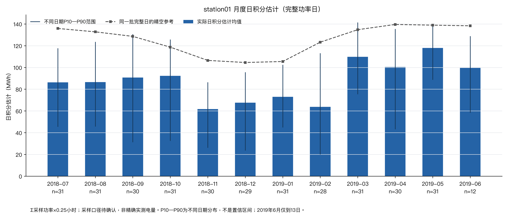
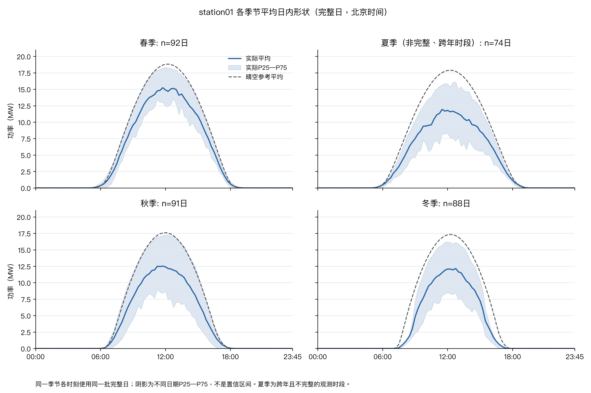
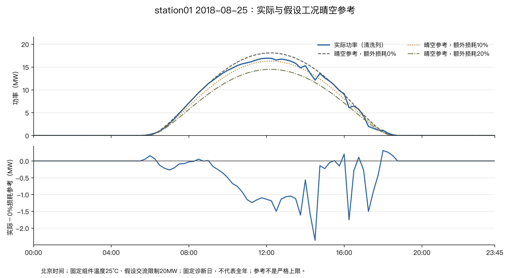
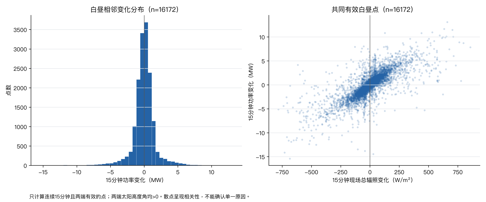

# 光伏电站发电功率日前预测建模——基于历史功率与数值天气预报的方法

> **MathorCup 大数据竞赛 · B 题 · 论文内容骨架**
> 由 C（验证与论文负责人）维护。结构严格对齐官方《论文模板》与《论文格式及提交规范》。
>
> **写作规则**
> 1. 今天写不准的，先占位并写清「待补什么」，**不留模糊结论**。
> 2. 论文里**每个数值都要能指到 `results/` 里的某个文件**；指不到的就删掉那句话。
> 3. 每张结果表都要能回答：**这批样本的起报时刻是什么？每个特征在起报时真的拿得到吗？**

---

## 队伍信息

| 项目 | 内容 |
|---|---|
| 队伍编号 | `MCB250XXXX`（待填真实队号） |
| 赛道 | B |

> ⚠️ 模板首页队号写法为 `MCB250XXXX`，提交规范文件名却为 `B2500XXX`（例 `B2500001.pdf`）——两种写法不一致，**需与队友/官方确认以哪个为准**。

---

## 摘要

> **最后写。** 必须覆盖：每问用了什么方法 ＋ 关键**精确数值**（如容量归一化 RMSE 由 A 降到 B）＋ 主要结论与局限。
> **禁止**出现「效果显著提升」而不给数字。A、B 只能来自真实运行表。

（摘要正文）

**关键词：** 光伏功率预测；日前预测；数值天气预报；时序基线；误差评估

---

## 目录

> 提交前在 Word 中自动生成；此处仅列出结构。

1. 问题重述与任务拆解
2. 数据来源、字段、单位、清洗与可用信息
3. 模型假设与符号说明
4. 问题 1：参考功率与时序特性
5. 问题 2：历史功率预测、基线与评估
6. 问题 3：NWP 信息增益与场景比较
7. 问题 4：空间处理方法与可行性检验
8. 局限、改进方向与结论
9. 参考文献
- 附录

---

## 1 问题重述与任务拆解

**背景**：电网需提前安排次日供电计划，而光伏出力随天气剧烈变化，故需建立日前功率预测方法。

**四问拆解**（各问的硬性输出要求）：

| 问 | 任务 | 必须输出的结果 |
|---|---|---|
| Q1 | 参考功率与时序特性 | 晴空参考功率曲线；月度 / 季节 / 日内特性；实际与参考偏差及其物理解释 |
| Q2 | 仅用历史功率的预测 | 两套朴素基线 + 回归模型的逐日 96 点预测表、四个测试周指标、最差日解释 |
| Q3 | 引入 NWP 的预测 | M0（无 NWP）/ M1（含 NWP）同模型对照、分场景误差、误差下降比例 |
| Q4 | 空间处理方法 | 空间映射方案对比及对功率误差的影响、可行性边界说明 |

**关键口径（全队唯一来源：`docs/里程碑跟踪板.md`；C 负责复核一致性）**：

| 口径 | 定义 | 状态（截至 10/12） |
|---|---|---|
| K1 「最后一周」 | 该月最后一个完整自然周（周一–周日）；跨月取该月最后 7 个完整日 | ⚠️ **待确认** |
| K2 白昼判据 | 太阳高度角 > 0° **且** 晴空 GHI > 20 W/m² | ⚠️ **待确认** |
| K3 装机容量 C | 恒定值，全部误差指标按 C 归一化（附件1 要求） | ✅ 已定（口径内涵见 §2-G2） |
| K4 训练 / 测试划分 | 测试 = 第 2/5/8/11 月最后一周，其余为训练集 | ✅ 已定（题目规定） |
| K5 起报机制 | 逐日起报 00:00，预报未来 24 h；连续 7 天构成表 2 | ⚠️ **待确认** |
| K6 指标统计范围 | 仅白昼时段（题目要求 (3)） | ✅ 已定 |

> **C 复核（口径一致性）—— 两处必须先定案，否则全文不自洽：**
> 1. **白昼口径存在两套写法**：里程碑板 K2 要求「高度角 > 0° **且** 晴空 GHI > 20 W/m²」，而 §4 正文（station01 流程）采用「几何太阳高度角 > 0」。二者样本数不同，而所有误差指标都在白昼样本上评估 → **必须二选一，并在 §3 符号说明处固定。**（C 复核 C1，见 §4.8）
> 2. **「7 天」的解释必须写进正文**：测试周内应为**每天做一个日前预测**（每天 96 点），而非一次预测 672 点。若正文不写此句，672 点样本口径无法与附件1 对齐。
>
> 数字来源：规则 / 需求表 + 原题 + `docs/里程碑跟踪板.md`。

---

## 2 数据来源、字段、单位、清洗与可用信息

> 本节为 C（独立验证）据实际读表所得，是本问「诚实度」的核心交付。完整核对记录见 `docs/角色C_第一问数据核对.md`。

### 2.1 来源与字段（已独立复算）

- **来源**：PVOD v1.0 公开数据集（含论文与 DOI，见 §9 参考文献）。
- 以 station01 直读 CSV 复算结果为例：

| 项 | 实测值 | 与文档是否一致 |
|---|---|---|
| 行数 / 列数 | 33 408 / 15 | ✅ |
| 时间戳唯一性 | 全部唯一，均落在 15 min 网格 | ✅ |
| 时间范围（UTC） | 2018-06-30 16:00 → 2019-06-13 15:45 | ✅ |
| 时区 | 原始 UTC，转 Asia/Shanghai | ✅ |
| 功率单位 | MW | ✅ |
| 现场气象 | 6 列 `lmd_*`（辐照 / 温度 / 气压 / 风向 / 风速） | ✅ |
| NWP 字段 | 7 列 `nwp_*` | ⚠️ 值齐备，但**起报语义未证实** |
| 站表 | 117.45722°E / 38.18306°N，倾角 South 33° | ✅ |
| 容量换算 | 74 000 × 270 Wp = 19.98 MWp | ✅ |

### 2.2 清洗与对齐方法

- 缺测 / 异常比例、持值段（frozen runs）处理：已由问题1 流程产出于 `results/q1/station01/cleaning_summary.json`、`frozen_runs.csv`、`cleaning_log.csv`。
- ⚠️ **功率是瞬时值还是区间均值、时间戳落在区间头还是尾 —— 未确认**（G3）。
- ⚠️ **切到 15 min 的方法**（5 min 平均汇总 / 插值）—— 未在文档中明确。
- 清洗规则细节与逐值处理原因见 §4.1 正文。

### 2.3 数据「满足了什么」（C 核对结论）

| 要求 | 状态 | 证据（可溯源） |
|---|---|---|
| 公开可追溯数据来源 | ✅ | `docs/data_sources.md` §1 / §7 |
| 15 min 分辨率 | ✅ | 全时间戳唯一且落网格 |
| 时间戳无重复 / 无缺失 | ✅ | `summary.json`（duplicate=0, missing=0） |
| 时区已定档 | ✅ | UTC → Asia/Shanghai |
| 地理与倾角信息 | ✅ | `metadata.csv` |
| 装机容量 | ✅（口径待定） | `Capacity=20000` kW |
| 组件级参数可交叉验证 | ✅ | 74 000 × 270 Wp = 19.98 MWp |
| NWP 字段齐全 | ✅（语义待证） | 7 个 `nwp_*` 列 |
| 现场实测气象 | ✅ | 6 个 `lmd_*` 列 |
| 四个测试周时间覆盖 | ✅ | `test_week_coverage.csv`，各 672 条，共 2688 |
| 问题1 结果表齐备 | ✅ | `results/q1/station01/` 共 31 个文件 |
| **结果可溯源设计** | ✅ **优秀** | `q1_evidence_index.csv` 155 条 claim，逐条带 source_file + selector |
| 输入哈希留痕 | ✅ | `summary.json` 记录 `source_sha256` |

### 2.4 数据「缺了什么」（C 核对结论）

| # | 缺口 | 影响 | 严重度 |
|---|---|---|---|
| G1 | 海拔缺失 | 只影响问题1 晴空参考 | 🟡 中 |
| G2 | **AC/DC 容量口径未确认** | 分母 C 决定全部误差指标 | 🔴 高 |
| G3 | **功率采样口径未知** | 影响日电量积分合法性 | 🔴 高 |
| G4 | **NWP 起报 / 发布时间未提供** | 无法证明「起报时刻已知」→ 阻塞问题3 因果性 | 🔴 高 |
| G5 | 无开机容量时序 | 只能用恒定装机容量近似 | 🟡 中 |
| G6 | 观测不足完整一年 | 季节结论适用性受限 | 🟡 中 |
| G7 | 无邻近 NWP 格点 | 经典空间降尺度不可行 | 🟠 中高 |
| G8 | 实测辐照标定疑点 | 影响问题1 偏差归因的定性 | 🔴 高 |

> **G2 关键新发现（C 全站交叉验证）**：`Capacity = 直流容量` 这一口径**只对部分站点成立** ——
> station01(−0.1%)、station07(0.0%)、station00(+0.5%) 吻合，但 station06(+1.9%)、**station08(+3.4%)** 偏离，
> 而 station08 恰是外部方案包的主站点。故该口径**必须全队定案**并写入假设（详见 `docs/角色C_第一问数据核对.md` §2）。

### 2.5 ⚠️ 仓库混入一套**外部方案包**（非本队产出，须隔离）

**本队真实进度（据本队自己的记录）**：只用 **station01**、只做到**问题1**。证据：`docs/data_sources.md`（本队 A 撰写）写明「第一问选用 station01」并明确标注「**尚未训练预测模型**」；`README.md`、`src/q1_*.py`、`results/q1/station01/`、`figures/q1/station01_*` 全部只覆盖 station01 与问题1。**问题 2/3/4 尚未开始。**

**仓库里另有一批「问题1–4 + M6 稳健性全做完」的文件（全部围绕 station08），但那不是本队的产出**，而是协作者 `Cat-of-Laplace` 于 10-12 14:47~15:58 上传的**外部方案包**。判定依据（逐条可查）：

| # | 证据 | 说明 |
|---|---|---|
| E1 | `docs/里程碑跟踪板.md` 首行写「工作区：`C:\Users\35730\Desktop\数学建模`」 | **不是本队任何一台机器**（本队为 A 的 Mac + C 的 `C:\Users\34078`） |
| E2 | 同文件声明「我这边网络受限…无法访问外网，数据集必须由你或队友下载」 | 该环境**无外网**；本队环境有外网 |
| E3 | 同文件「未决事项」要求的主数据集是 **GEFCom2014 Solar** | 与本队实际采用的 **PVOD** 完全不同 → 两套工作互不知情 |
| E4 | `docs/结果汇总_真实数据.md` 引用的 `code/*.py`、`reports/*`、`_extracted/*` **全部不在仓库**（`code/`、`reports/`、`_extracted/`、`_tools/` 从未提交） | 方案包的代码留在产出地，只搬来报告 |
| E5 | `Cat-of-Laplace` 的提交信息为「数据整理」「**我也不知道这是什么**」 | 提交者本人亦未确认其性质 |

**涉及的「外部方案包」文件**（仅供方法参考，**不得当作本队进度或结论**）：
`docs/结果汇总_真实数据.md`、`docs/数据说明_PVOD.md`、`docs/里程碑跟踪板.md`、`docs/建模思路_B题光伏功率预测.md`、`docs/reports/*`（30 项）、`data/PVOD/*.csv`（10 站解压件）、`data/synthetic/*`。

**C 的处置建议**：
1. **§4 主体维持 station01 不变** —— 它是本队 A 的正式产出，且深度（12 个月度表 / 季节曲线 / 波动分布 / 155 条证据索引）远超方案包的摘要版。
2. **§5–§7 不得当作「本队已完成的证据」** —— 其数字来自外部方案包，代码不在仓库、原始环境不明，**无法溯源**。
3. 若全队决定沿用其方法与结论，须先做两件事：**① 让 `Cat-of-Laplace` 说明该包来源与授权；② 把 `code/` 脚本入库并能在本队环境重跑**。二者完成前，只能作为「方法参考」，不得写入正文数字。
4. **站选问题（station01 vs station08）不是本队的决策分歧** —— station01 是本队正式选择，station08 仅出现在外部包中。是否改站属**全队新决策**，需 A/B/C 一起定。

### 2.6 数据不足时的简化方案（按 C 清单要求写明）

题目硬约束的历史功率划分在 station01 上**可严格执行**，无需自制划分。其余缺口对应以下简化，**每条都必须在论文中显式声明，不允许静默采用**：

| 缺口 | 简化 | 声明要点 |
|---|---|---|
| G1 海拔 | 取 0 m | 「海拔未提供，取 0 m，高海拔会低估辐照」 |
| G2 容量口径 | 恒定装机容量 C 归一化 | 「未提供开机容量时序，按全设备在线近似」 |
| G3 采样口径 | 日电量按 ΣP×0.25h 矩形积分 | 「采样口径未确认，电量为估计」 |
| G4 NWP 起报 | 问题3 降级表述为「给定 NWP 值的融合效果」 | **不得称「日前预测」** |
| G6 不足一年 | 季节按 3–5 / 6–8 / 9–11 / 12–2 月分组 | 「非完整年，季节结论适用性受限」 |
| G7 无邻近格点 | 问题4 改用跨站空间信息借用 | 「经典降尺度不可行，本问为方法迁移实证」 |
| 合成数据 | `data/synthetic/` 仅用于代码自检 | 精度结论不得写入正文 |

---

## 3 模型假设与符号说明

### 3.1 模型假设（逐条列，须与后文实际做法一致）

| # | 假设 | 依据 / 影响 |
|---|---|---|
| A1 | 全部设备在线时，用恒定装机容量近似「开机容量」C | 未提供开机容量时序；影响全部归一化指标 |
| A2 | 海拔缺失时取 0 m | 影响晴空辐照标度（G1） |
| A3 | 组件温度固定 25°C（参考工况） | 现场气温非组件温度 |
| A4 | 逆变器额定效率 0.96、额外损耗基准 0%（另设 10%/20% 情景） | PVWatts 通用默认，非站点实测 |
| A5 | 散射按各向同性、地面反射率 0.25 | 通用参考条件 |
| A6 | 日电量用矩形积分估计：$\widetilde E_d=0.25\sum_{k=1}^{96}P_k$ | 采样口径未确认（G3） |
| A7 | 缺失值不插值、不补零；仅完整日进月度统计 | 完整日定义见 §4.1 |
| A8 | 未证实原因的现象（辐照正常而功率为 0）只标记、不断言故障 | 无运维 / 测量状态资料 |

### 3.2 符号说明

| 符号 | 含义 | 单位 |
|---|---|---|
| $P_i$ | 实际功率（清洗后） | MW |
| $\hat P_i$ | 预测功率 | MW |
| $C_i$ | 开机容量（取恒定装机容量） | MW |
| $e_i=(P_i-\hat P_i)/C_i$ | 逐点容量归一化误差 | 无量纲 |
| $E_{rmse}$ | 均方根误差 | 无量纲 |
| $E_{mae}$ | 平均绝对误差 | 无量纲 |
| $E_{me}$ | 平均误差（偏差） | 无量纲 |
| $r$ | Pearson 相关系数（**辅助量，非精度**） | 无量纲 |
| $C_R=(1-E_{rmse})\times100$ | 准确率 | % |
| $Q_R$ | 合格率（$|e_i|<0.25$ 占比） | % |
| $PR$ | 系统效率 $=P_{real}/P_{theo}(实测辐照)$ | 无量纲 |
| $k_c$ | 天气折减 $=GHI_{实测}/GHI_{晴空}$ | 无量纲 |

### 3.3 六指标口径（附件1，C 已手算验证）

- 输入 容量 C=[10,10]、实际 P=[2,4]、预测 P̂=[1,6] → `E_mae=0.15`、`E_rmse=0.158114`、`E_me=−0.05`、`C_R=84.189%`、`Q_R=100%`，**全部命中**。
- **三个必须守住的坑**：① 分母是**开机容量 C**，不是实际功率，也不能用 MAPE 顶替；② **所有方法共用同一批白昼样本**；③ `r` 是辅助量，两点序列必然算出 r=1（无意义），常数序列 r 无定义须记 NaN。
- 白昼定义（K2 / §4.1 两套之一，待定案）及「所有方法统一使用」的声明须在此固定。

> **C 复核**：假设 A1–A8 是否与后文实际做法一致；白昼口径（K2 vs §4 写法）全文是否统一；容量与采样口径的声明是否与 §2.6 简化方案一致。

---

## 4 问题1：参考功率与时序特性

> 本节为第一版审阅稿。所有统计来自本项目实际运行结果；真实测量口径和设备参数尚不完整，以下结论限定于当前观测、清洗规则及明确假设。第一问仍待A、C复核后定稿。

### 4.1 数据与分析口径

选取PVOD v1.0的station01电站进行分析[Q1-1]。数据按UTC解析并转换为北京时间，覆盖2018年7月1日至2019年6月13日，共348个观测日、33,408条记录，采样间隔为15分钟。时间戳连续且唯一，原始功率列单位为MW。该站没有覆盖完整一年，因此本节属于现有观测时段的特性分析。

在质量复查中，两段功率及六项现场气象量逐点相同的记录持续至深夜，而同期NWP仍在变化。对此保留原始列及每段首点，将后续重复点的现场清洗值设为缺失，未插值或补零。具体段边界和逐值处理原因均保留，数据异常的真实采集或填补原因尚不能确认。

清洗版本为q1-station01-v1。持值候选要求至少4个连续15分钟点、七项现场量完全相同，且段内包含太阳高度角低于-6°、功率大于0.01 MW、总辐照为正的样本。保留每段首点是“可能为最后一次有效采样”的工作假设，不表示首点已获独立验证。白昼低功率复查阈值为现场总辐照大于200 W/m²且功率不大于0.01 MW；这类点只标记。

第一版清洗产生138个功率缺失值，保留345个完整功率日用于月度和平均日内分析。完整日要求北京时间当天的96个15分钟时间点全部存在且功率清洗值有效。另有65个白昼有较强辐照却功率接近零的点，以及6个近地平线夜间小正功率点被保留并标记；缺少运维及测量状态资料时，不将它们直接判为故障或删除。

功率是瞬时样本还是区间平均值、时间戳对应区间头还是尾，当前均未确认。本节采用矩形积分近似：

$$\widetilde E_d=0.25\sum_{k=1}^{96}P^{\mathrm{clean}}_{d,k}\quad(\mathrm{MWh}).$$

这里的日积分是发电量估计。只有在功率为对应15分钟区间均值且区间归属正确时，上式才可直接解释为日发电量；若为瞬时样本，则是数值积分近似。不完整日不补零，也不进入月度完整日均值。每月实际和参考使用同一批完整日，避免样本集合不同造成比较偏差。

白昼统一定义为几何太阳高度角大于0。偏差统计使用实际与参考均有效的白昼点；15分钟变化进一步要求两个端点均有效、均在白昼且时间差恰为15分钟。这些样本集合与完整日集合不同，以下分别报告数量。

结果依据：`summary.json`、`cleaning_summary.json`、`frozen_runs.csv`、`cleaning_log.csv`、`daily_characteristics.csv`。

### 4.2 晴空参考功率模型

依据站点经纬度计算太阳位置，再采用Ineichen晴空模型生成GHI、DNI及DHI[Q1-2]。结合组件朝向和倾角，以各向同性散射模型计算板面总辐照[Q1-3]。站点坐标、组件配置和倾角来自metadata.csv，其他暂缺参数按表4-1明示假设，不利用实际功率拟合。

表4-1 参考模型参数及来源

| 项目 | 第一版取值 | 属性与依据 |
|---|---|---|
| 经度、纬度 | 117.45722°E、38.18306°N | station01元数据 |
| 倾角、方位角 | 33°、180°（朝南） | 元数据South 33°；正北0°顺时针方位约定 |
| 组件数、单组件Pmax | 74000块、270 Wp | 元数据Panel_Number及Module |
| 组件额定直流容量 | 19.98 MWp | 组件数与Pmax相乘，非已核实交流容量 |
| 海拔 | 基准0m，敏感性200m | 均为假设，不是实测海拔 |
| 组件温度 | 固定25°C | 参考工况；现场气温不是组件温度 |
| 交流功率限制 | 暂设20 MW | 实测输出及装机容量的AC/DC口径尚未核实 |
| 逆变器额定效率 | 0.96 | 通用PVWatts模型默认假设，非站点逆变器实测值 |
| 散射、地面反射 | isotropic、反射率0.25 | 通用参考条件；未核实地表和积雪变化 |
| 额外损耗 | 基准0%，另设10%、20% | 只作敏感性情景，不认定为真实损耗 |

固定组件温度为参考温度时，采用简化的辐照比例功率关系[Q1-4]：

$$P_{\mathrm{dc,ref}}(t)=19.98\frac{G_{\mathrm{poa}}(t)}{1000}(1-L)\quad(\mathrm{MW}),$$

其中板面辐照$G_{\mathrm{poa}}$的单位为W/m²，$L$为额外损耗率。该关系把板面辐照近似作为有效辐照，未加入入射角、光谱和遮挡细节。随后使用PVWatts逆变器模型，将直流功率映射为参考交流功率，并限制于假设的交流容量[Q1-5]。逆变器DC输入限制采用交流限制除以额定效率，与组件额定直流容量分开定义，避免混用。额外损耗和逆变器损耗也分别计算。

基准定义为海拔0m、额外损耗0%的晴空参考，夜间参考功率置0。所有实测与参考按同一时间戳作点值对齐。由于实测AC/DC及区间口径仍待确认，这是一种工作假设下的近似比较，不能声称已完成真实设备口径核验。参考曲线既不是任何天气下的严格发电上限，也不是未来功率预测。

结果依据：`reference_summary.json`、`reference_power.csv`；参数详见`docs/q1_reference_assumptions.json`。

### 4.3 月度变化与平均日内形状

表4-2列出各月完整日的日积分估计均值。图4-1同时显示实际均值、不同日期的P10—P90范围及同日参考均值，范围反映样本日期之间的分布，不是置信区间。

表4-2 各月完整日的日积分估计

| 月份 | 观测日 | 完整功率日 | 实际日积分估计均值（MWh） | 同日参考均值（MWh） |
|---|---:|---:|---:|---:|
| 2018-07 | 31 | 31 | 86.33 | 135.87 |
| 2018-08 | 31 | 31 | 86.51 | 132.76 |
| 2018-09 | 30 | 30 | 90.71 | 128.58 |
| 2018-10 | 31 | 31 | 92.24 | 118.68 |
| 2018-11 | 30 | 30 | 61.72 | 106.48 |
| 2018-12 | 31 | 29 | 67.59 | 104.56 |
| 2019-01 | 31 | 31 | 72.97 | 105.48 |
| 2019-02 | 28 | 28 | 63.70 | 123.24 |
| 2019-03 | 31 | 31 | 109.79 | 134.73 |
| 2019-04 | 30 | 30 | 100.47 | 139.55 |
| 2019-05 | 31 | 31 | 117.94 | 138.92 |
| 2019-06 | 13 | 12 | 99.54 | 138.32 |

图4-1 月度日积分估计与同日晴空参考；仅使用完整功率日，采样口径待确认。

在当前样本与积分近似口径下，2019-05的日均估计最高，为117.94 MWh，来自31个完整日；2018-11最低，为61.72 MWh，来自30个完整日。实际月度排序与“夏季必然最高”的预设不一致。晴空参考冬季较低、春夏较高，体现了该物理模型中的太阳几何和气候大气参数变化；实际曲线同时受真实天气、运行状态与测量因素影响，当前不能分离各因素的贡献。

2019年6月仅覆盖1—13日，且一个日期因清洗缺失未进入完整日统计；该月均值不能推广到整个6月。清洗前全观测日均值另存于monthly_characteristics.csv，但与完整日均值的日期集合不同，不应把二者差异当作同样本清洗效果。

按3—5月、6—8月、9—11月、12—2月分别归为春、夏、秋、冬。每个季节的所有日内时刻使用同一批完整日，图4-2阴影为不同日期的P25—P75范围。表4-3的峰值是平均曲线峰值，不是每日最大功率或太阳正午。

表4-3 观测时段各季节平均日内曲线

| 分组 | 完整日 | 平均曲线峰值（MW） | 峰值时刻（北京时间） | 实际包含月份 |
|---|---:|---:|---|---|
| 春季 | 92 | 15.24 | 11:45 | 2019-03, 2019-04, 2019-05 |
| 夏季（跨年、不完整） | 74 | 11.94 | 11:30 | 2018-07, 2018-08, 2019-06 |
| 秋季 | 91 | 12.52 | 11:45 | 2018-09, 2018-10, 2018-11 |
| 冬季 | 88 | 12.16 | 12:45 | 2018-12, 2019-01, 2019-02 |

图4-2 平均日内形状及不同日期的P25—P75范围；各面板使用相同功率尺度。

各组平均曲线均呈现从早晨上升、在中午附近达到峰值、傍晚下降的日内结构。春季样本平均峰值较高，但夏季合并了2018年7/8月和2019年6月1—13日，既跨年又不完整，不能据此认定完整夏季的发电水平低于其他季节。季节平均差异仍需结合气象和运行资料解释。

结果依据：`monthly_characteristics.csv`、`seasonal_characteristics.csv`、`seasonal_diurnal_profiles.csv`。

### 4.4 实际与参考偏差及短时波动

定义偏差为$d(t)=P_{\mathrm{actual,clean}}(t)-P_{\mathrm{ac,ref}}(t)$；负值表示实际低于该参考工况，不等同于设备损耗。

在16,520个共同有效白昼样本上，基准平均偏差为-3.168 MW，平均绝对偏差为3.364 MW；有3,091个点的实际值高于参考。这些量是对假设物理参考的偏离描述，不是第二问的预测误差或准确率。

图4-3选取固定诊断日2018-08-25展示实际和各损耗情景参考。该日用于解释曲线，不因表现较好而宣称具有全年代表性。对全部月份的白昼偏差仍保留完整统计，见表4-4。

图4-3 固定诊断日实际/参考对比；固定组件温度及交流限制等均有假设。

表4-4 按月的基准白昼偏差

| 月份 | 有效白昼点数 | 平均实际－参考（MW） | 平均绝对偏差（MW） | 实际高于参考比例 |
|---|---:|---:|---:|---:|
| 2018-07 | 1785 | -3.442 | 3.486 | 10.64% |
| 2018-08 | 1669 | -3.436 | 3.544 | 15.40% |
| 2018-09 | 1475 | -3.081 | 3.359 | 31.32% |
| 2018-10 | 1373 | -2.388 | 2.798 | 33.21% |
| 2018-11 | 1201 | -4.472 | 4.487 | 2.75% |
| 2018-12 | 1137 | -3.783 | 4.037 | 12.23% |
| 2019-01 | 1198 | -3.364 | 3.576 | 11.85% |
| 2019-02 | 1188 | -5.613 | 5.821 | 9.34% |
| 2019-03 | 1464 | -2.113 | 2.591 | 31.63% |
| 2019-04 | 1566 | -2.995 | 3.147 | 20.56% |
| 2019-05 | 1746 | -1.490 | 1.623 | 24.40% |
| 2019-06 | 718 | -2.607 | 2.647 | 12.53% |

各月平均偏差均为负，但仍有实际高于参考的时刻。温度、大气和设备参数与假设不一致，都可能影响偏差；缺少实际组件温度、运维和容量口径等资料，不能将平均偏差唯一归为云遮挡、故障或系统损耗。

相邻功率变化定义为$\Delta P(t)=P(t)-P(t-15\mathrm{min})$，仅对时间连续且两个端点有效的点计算。图4-4左侧给出白昼变化分布，右侧比较同期现场总辐照变化。

共有16,172个有效白昼点对；绝对变化中位数为0.675 MW，P95为3.570 MW，最大为15.398 MW。功率与辐照变化的Pearson相关系数为0.783，表明样本中存在同向变化关系，但不证明唯一因果机制。

图4-4 白昼连续15分钟变化分布与现场辐照变化散点；缺失和跨时间缺口的点对不计入。

两类事件说明为何不能统一归因。2019-03-30 14:15，功率相对前一采样点下降15.398 MW，现场总辐照下降684.5 W/m²，支持功率与辐照同步变化的描述。2018-12-27 11:15，功率下降14.456 MW并降为零，但同期辐照增加28.8 W/m²，此时现场总辐照仍约470.7 W/m²。后者无法仅凭辐照下降解释，停机、限电或测量问题只能列为待核实可能性，不能写为已确认原因。两类原始事件都保留，未因事后解释删除。

结果依据：`reference_sensitivity.csv`、`monthly_daylight_deviation.csv`、`largest_daylight_changes.csv`、`zero_power_daylight_events.csv`。

### 4.5 参考假设敏感性

保持组件配置和同一批白昼样本不变，分别调整额外损耗与海拔假设。表4-5展示已有四个情景。0%、10%、20%为人为设定情景，并非真实损耗估计；200m也不是已确认海拔。

表4-5 参考假设敏感性（共同有效白昼样本）

| 情景 | 参考峰值（MW） | 平均实际－参考（MW） | 平均绝对偏差（MW） |
|---|---:|---:|---:|
| 海拔0m，额外损耗0%（基准） | 19.246 | -3.168 | 3.364 |
| 海拔0m，额外损耗10% | 17.337 | -2.119 | 2.856 |
| 海拔0m，额外损耗20% | 15.422 | -1.068 | 2.708 |
| 海拔200m，额外损耗0% | 19.361 | -3.210 | 3.395 |

增大假设额外损耗后，参考曲线下降，样本中的平均绝对偏差也减小。这说明实际/参考偏离的幅度依赖模型假设，不能因20%情景更接近实际就认定电站真实损耗为20%。当前敏感性检验只涉及少量参考参数，没有验证真实温度效应、逆变器配置，也尚未完成积分方法和清洗首点处理的敏感性。

结果依据：`reference_sensitivity.csv`。

### 4.6 本问结论与局限

第一，在当前完整日与积分近似下，实际发电水平具有月度差异：2019-05最高，2018-11最低。平均日内功率在中午附近较高，具体峰值随观测分组变化。

第二，真实功率总体低于本次基准晴空参考，但也存在超过参考的时刻。因温度、设备和气候参数有简化，参考只用于描述条件明确的物理偏差，不能直接视为严格上限或设备损耗真值。

第三，短时功率变化与现场辐照变化呈正相关，同时存在辐照未下降却功率降为零的事件。解释发电特性应同时考虑天气与运行/测量信息，当前无法确认全部事件原因。

结论适用范围受以下限制：数据不足完整一年；夏季跨年且不完整；功率采样和时间戳口径未核实，电量为积分估计；真实AC/DC、海拔、组件温度和系统损耗参数未齐；持值首点和其他可疑记录保留；月度/季节比较未控制气象与运行因素。这些限制应随结论一起保留，不能只放在附录。第一问可以形成有证据的练习初稿，但真实物理口径一致性的完成条件仍未核实。

### 4.7 引用与复核备注（编辑用，合并正文时统一处理）

本章临时引用使用Q1前缀，合并全文时由C按首次出现顺序统一编号。复核状态尚未由A或C签认。

- [Q1-1] Yao, T., Wang, J., Wu, H., et al. A photovoltaic power output dataset: Multi-source photovoltaic power output dataset with Python toolkit. Solar Energy, 2021, 230: 122–130. [DOI](https://doi.org/10.1016/j.solener.2021.09.050)。数据集DOI：[10.11922/sciencedb.01094](https://doi.org/10.11922/sciencedb.01094)。
- [Q1-2] pvlib contributors. [Location.get_clearsky](https://pvlib-python.readthedocs.io/en/stable/reference/generated/pvlib.location.Location.get_clearsky.html)。
- [Q1-3] pvlib contributors. [get_total_irradiance](https://pvlib-python.readthedocs.io/en/stable/reference/generated/pvlib.irradiance.get_total_irradiance.html)。
- [Q1-4] pvlib contributors. [pvwatts_dc模型公式](https://pvlib-python.readthedocs.io/en/stable/reference/generated/pvlib.pvsystem.pvwatts_dc.html)。本方案采用固定参考温度的简化式，并明确忽略有效辐照中的部分损失。
- [Q1-5] pvlib contributors. [pvwatts逆变器模型](https://pvlib-python.readthedocs.io/en/stable/reference/generated/pvlib.inverter.pvwatts.html)。

文献与方法资料访问日期：2026-10-12。本次运行pvlib版本见reference_summary.json。

**数字和结果表路径约定：**上述结果文件均位于`results/q1/station01/`。`q1_evidence_index.csv`为章节数字索引；它不代替原始结果表。站点物理参数来源是ZIP内metadata.csv及参考假设文件。

**A复核：**检查假设与解释是否匹配原题，尤其容量、采样口径、异常事件的原因边界。

**C复核：**抽查数字索引与表格、图号与图片、样本集合、单位及引用编号；不能把本章MAE写为第二问预测精度。

### 4.8 C 独立复核批注（2026-10-12，不改动 §4.1–§4.6 正文）

> C 已对 §4 做独立复算与可溯源抽查。**以下为审阅意见，供整理时处理，不代表已签认。**

**✅ 已独立复算、一致（可放心写进论文）**
- 时间戳、时区、分辨率、站表信息：直读 CSV 复算，**全部一致**。
- 容量换算 74 000 × 270 Wp = 19.98 MWp：一致。
- 附件1 六指标口径：手算验证**全部命中**（见 §3.3）。
- `q1_evidence_index.csv`（155 条 claim，逐条带 source_file + selector）：**可溯源设计优秀，建议问题2–4 沿用。**

**🟠 需在正文补强或与全队对齐的**

| 编号 | 问题 | 处理建议 |
|---|---|---|
| C1 | **白昼口径不统一**：§4.1 用「几何太阳高度角 > 0」，里程碑板 K2 用「高度角 > 0 **且** 晴空 GHI > 20 W/m²」 | 二选一并全文统一（§1 口径表） |
| C2 | **容量口径**：§4.2 表 4-1 已诚实标注「19.98 MWp 为组件额定直流容量、AC 口径未核实」，**做法正确** | 但 station08 的 `Capacity` 与组件容量差 3.4%（§2-G2）→ 两站口径须统一说法 |
| C3 | **辐照标定**：§4.4 偏差归因依赖现场辐照。station01 侧 η_p90 = 1.006（>1，物理不可能） | §4.4/§4.6 须写明「辐照标定不确定性是本问偏差归因的首要误差源」，不可把单站损失分解当作普遍结论 |
| C4 | **证据断裂**：`results/q1/station01/` 的 `summary.json` 中 `source` 路径为 `/Users/Admin1/…`（macOS）→ 系 **A 在其 Mac 上产出**，且原始 ZIP 未入库 | 该结果**非本机可复现**（按 README 走必然失败，§2-P4）；须补数据获取说明或把 ZIP 入库 |
| C5 | **引用编号**：§4.7 的 Q1-x 临时编号 | 合并全文时按首次出现顺序统一（作者已注明，C 确认接收） |

> 完整核对记录与 6 处问题定级见 `docs/角色C_第一问数据核对.md`。

---

## 5 问题 2：历史功率预测、基线与评估

> ⚠️ **本章数字来自「外部方案包」（station08），非本队产出，代码不在仓库、无法溯源。以下内容仅作方法参考，不得作为本队已完成证据、不得写入正文；本队问题2 尚未开始。**（见 §2.5）

### 5.1 允许的输入

**起报前**的功率曲线、过去若干天统计、已知日历信息；**不含**未来观测与 NWP（问题2 与问题3 的输入必须严格隔离，否则问题3 的「NWP 是否有效」失去意义）。

### 5.2 朴素基线（现有证据）

外部方案包已产出三级基线（测试集仅白昼 n=5367，station08）：

| 模型 | E_rmse | E_mae | E_me | r | Q_R | C_R |
|---|---|---|---|---|---|---|
| 持续性基线 | 0.2186 | 0.1494 | −0.0700 | 0.6046 | 0.782 | 0.781 |
| 气候态基线 | 0.1546 | 0.1121 | −0.0580 | 0.7967 | 0.874 | 0.845 |
| 物理基线（晴空几何 × 训练集效率） | 0.1650 | 0.1122 | +0.0962 | 0.8362 | 0.875 | 0.835 |
| **物理模型（单参数功率曲线）** | **0.1452** | 0.1140 | −0.0459 | 0.8306 | 0.894 | 0.855 |
| GBDT-仅历史 | 0.1655 | 0.1274 | −0.0930 | 0.8372 | 0.846 | 0.835 |

来源：外部方案包 `docs/结果汇总_真实数据.md`（问题2）。**⚠️ 出处脚本 `code/run_predict.py` 不在仓库（P1），且产出环境不明；须先说明来源并纳入版本控制，方可考虑引用。**

### 5.3 回归模型与结果要点（外部方案包，仅作参考）

- 物理模型（0.1452）优于 GBDT（0.1655），DM p=2.2e−16，CI 不含 0。
- **关键防泄漏说明**：预测 D 日时，滞后 48 h（192 点）通常可用，滞后 **24 h 同刻通常不可用**；每个特征的可得性须逐条回答「起报时刻真的拿得到吗」。
- **⚠️ 结论须限定范围**：M6 跨站稳健性显示该优势**仅 station08/07 成立，station06/00 不成立（2/4）** → 论文不得宣称「物理模型普遍更优」，应表述为「在主站点上更优，且优势随装机容量减小而更明显」。
- 消融发现：剔除「时间周期」组 RMSE 反降（与太阳几何信息高度重叠）→ 属消融实验所得，不能凭直觉假设。
- **以上全部为外部方案包结论，本队问题2 需自行重做。**

### 5.4 待补清单（C 视角）

- [ ] 本队自行做问题2（station01），产出四个测试周逐点预测表。
- [ ] 补「表现最差日」的解释。
- [ ] 把 `code/` 脚本入库，否则本章所有数字不可溯源（P1）。
- [ ] C 独立用 `metrics.py` 复跑指标，确认基线与模型**同一批白昼样本**。

---

## 6 问题 3：NWP 信息增益与场景比较

> ⚠️ 同 §5：以下数字来自外部方案包（station08），**非本队产出、不可溯源，不得并入正文**。

### 6.1 对照设置

M0（仅历史 + 时间特征）→ M1（同模型 + 起报前已发布的 NWP 辐照 / 气温 / 云量）。

### 6.2 每个天气特征的「三次问答」

**哪次预报发布？预测哪个有效时刻？起报时刻能拿到吗？** —— ⚠️ 本题数据**未提供 NWP 起报时间 / 版本**（G4）→ 目前**无法证明** NWP 在起报时刻已知。**因此本章结论必须降级表述为「给定 NWP 情形下的融合效果」，不得称「日前预测」。**

### 6.3 场景划分

按预报晴空指数（水平面口径）分档：晴 `k_c`>0.65 / 多云 0.35–0.65 / 阴 ≤0.35（阈值在训练 / 验证里定，测试周按固定规则分组）。三档占比 65.8% / 19.7% / 14.5%，均非平凡 → 分档自然可行。

### 6.4 结果要点（外部方案包，station08，仅作参考）

| 模型 | E_rmse | E_mae | r | Q_R |
|---|---|---|---|---|
| GBDT-仅历史（问题2） | 0.1655 | 0.1274 | 0.8372 | 0.846 |
| **GBDT + NWP（问题3）** | **0.1166** | 0.0850 | 0.8896 | **0.951** |
| 物理模型（问题2，仅几何） | 0.1452 | 0.1140 | 0.8306 | 0.894 |
| 物理模型（问题3，用 NWP 辐照） | 0.1449 | 0.1017 | 0.8057 | 0.912 |

- **核心结论**：「NWP 是否有效」**取决于模型形式** —— 对数据驱动模型 NWP 增益 **+29.5%（显著）**；对单参数物理模型仅 **+0.2%（p=0.944，不显著）**。
- **M6 稳健性**：数据驱动 NWP 增益在 **4/4 站点 × 5/5 种子 × 4/4 切分**下全部显著（+18.8%~+29.5%）→ **可作主结论**。
- 但「物理模型 NWP 增益不显著」**仅 station08 成立（1/4）**，另 3 站该增益为显著负值 → **不可推广**，只能表述为「物理模型对 NWP 的利用能力不稳定」。
- 逐变量消融：`nwp_t_amb`（气温）单变量剔除影响最大，但置换重要性 `nwp_poa` 遥遥领先 —— 共线特征上单变量消融会低估重要性，需交叉验证。

### 6.5 结论边界

一周或少数天气样本的改善不能推广到全年；**对照必须公平（只有 NWP 一个变量变）**；场景「起报可选」还是「事后解释」须写清；**变差的组也要报**。

### 6.6 待补清单（C 视角）

- [ ] 本队自行做问题3；确认 M0/M1 只有 NWP 一个变量变（同一模型、同一选参流程、同一批白昼样本）。
- [ ] 补「变差的组也要报」。
- [ ] 确认场景划分在训练 / 验证里定阈值、测试周按固定规则分组。
- [ ] 把 `code/` 脚本入库（P1）。

---

## 7 问题 4：空间处理方法与可行性检验

> ⚠️ 同 §5 / §6：以下数字来自外部方案包（station08），**非本队产出、不可溯源，不得并入正文**。

### 7.1 空间问题定义

区别于时间插值：目标是把粗网格 NWP 映射到电站位置（降尺度）。

### 7.2 可行性诊断（三项独立检验，现有证据）

| 检验 | 方法 | 结论 |
|---|---|---|
| T1 时间分辨率 | 白昼每小时 15 min 取值是否重复 | **NWP 已是 15 min** → **时间降尺度无对象** |
| T2 空间格点 | 是否含格点索引列 | 每站仅**一条** NWP 序列，**无周围格点** → 经典空间降尺度不可行 |
| T3 多站空间信息 | 邻站 NWP 是否含本站之外的增量信息 | **有**（偏相关 0.12~0.30）→ 唯一可实证方向 |

> ⚠️ **修正记录（须在正文说明）**：曾据「白昼每小时仅 1.84~2.13 个不同 NWP 取值」误判 NWP 分辨率粗于 15 min；该统计**含大量夜间恒 0 小时**。按白昼分层后 0% 小时有重复值 → **典型「统计口径未分层」导致的误判**。

### 7.3 跨站空间信息借用（真实数据，严格测试集）

邻站：station07（24.0 km）、station06（61.5 km）、station00（175.7 km）。评估样本 = 测试掩码 ∩ 白昼 = **1236 点**。

| 目标 | 模型 | E_rmse | ΔRMSE vs S0 |
|---|---|---|---|
| 站点功率（最终目标） | S0 仅本地 NWP | 0.1387 | — |
| | S1 +邻站 NWP | 0.1340 | +3.4% |
| | **S2 +邻站 NWP + 空间梯度** | **0.1311** | **+5.5%** |
| 站点实测辐照 | S2 +邻站 NWP + 空间梯度 | 0.1757 | +2.5% |

- **显著性**：功率目标 DM p=0.057（**边缘显著**）；辐照目标 p=0.42（不显著）→ 诚实表述为「带来 +2.5%~+5.5% 改善，但受样本量（1236）与强自相关影响，显著性仅达边缘水平」，**不宜宣称「显著有效」**。
- **机理**：邻站 NWP 对本站残差的偏相关 0.12~0.30 且**不随距离单调衰减** → 增益来自**天气系统尺度**的云场信息，而非次网格云的生消。**直接回答题目「空间降尺度可否提高精度」：可以，但机制是「多源预报融合补足局地系统偏差」，而非「解析次网格云」。**
- **分辨率敏感性**：增益随 NWP 粗化倍数上升（S2 从 +2.5% 增至 +15.6%），支持「原始分辨率越粗、降尺度价值越大」；240 min 处回落，须如实说明。

### 7.4 结论边界

**「功率误差降低」不等于「气象真实分辨率提高」。** 单站单点 NWP 时证据不足，须如实写出。

### 7.5 ⚠️ 一处严重的评估缺陷（已修正，须写入局限）

问题4 初版评估**只用了 `is_day`，忘记叠加测试掩码**，把 11969 个（多为训练期）样本算进指标（正确仅 1236 点），使 RMSE 被低估（0.0897 vs 真实 0.1387）、增益被夸大（+9.4% vs 真实 +5.5%）。
**教训：任何评估都必须显式确认「评估样本 = 测试集 ∩ 有效时段」。本章现有数字已为修正后口径。**

### 7.6 待补清单（C 视角）

- [ ] 本队自行做问题4。
- [ ] 补合成多格点场的可控真值验证（强化机理结论）。
- [ ] 把 `code/` 脚本入库（P1）。
- [ ] C 确认「是否真有空间处理，别把时间插值当降尺度」—— 现结论已明确区分，✅。

---

## 8 局限、改进方向与结论

### 8.1 局限（由证据缺口逐条转化，每条须在正文保留，不能只放附录）

| # | 局限 | 来源缺口 | 涉及问题 |
|---|---|---|---|
| L1 | **仓库混入外部方案包**（station08、问题1–4），非本队产出、代码缺失、不可溯源；§5–§7 现有内容只能作方法参考 | §2.5 | 全文 |
| L2 | AC/DC 容量口径未确认，全部归一化指标依赖此口径 | G2 | Q2–Q4 |
| L3 | 功率采样口径未确认，日电量为积分估计 | G3 | Q1 |
| L4 | NWP 起报时刻未提供，无法证明「起报已知」→ 结论降级为「给定 NWP 情形」 | G4 | Q3 |
| L5 | 观测不足完整一年，夏季跨年且不连续 | G6 | Q1 |
| L6 | 无邻近 NWP 格点，经典空间降尺度不可行 | G7 | Q4 |
| L7 | 实测辐照标定有不确定性（两站偏差方向相反） | G8 | Q1 |
| L8 | `code/`、原始 ZIP 未入库，结果 A / B 不可复现 | P1 / P4 | Q2–Q4 |
| L9 | 「物理模型普遍更优」「物理模型 NWP 增益不显著」等结论跨站不稳 | M6 | Q2 / Q3 |

### 8.2 改进方向（可落地）

- 按天气状态（`k_c` 分档：晴 >0.65 / 多云 0.35–0.65 / 阴 ≤0.35）切换策略。
- 与日周期匹配的历史特征（时间周期项在已有太阳几何时冗余，可精简）。
- 明确容量与夜间约束；对辐照标定做独立校正。
- 空间侧：多源预报融合（跨站借用）已实证有效，可扩展为多格点网格降尺度。

### 8.3 总体结论（待本队完成问题2–4 后补精确数值）

- **能不能预测**：待本队问题2 完成后回答（外部方案包给出的 station08 参考值：物理模型 E_rmse 0.1452 vs 持续性基线 0.2186）。
- **加气象有没有用**：待本队问题3 完成后回答（外部方案包参考：取决于模型形式 —— 数据驱动 +29.5%，单参数物理模型 +0.2% 不显著）。
- **空间处理是否可行**：待本队问题4 完成后回答（外部方案包参考：跨站空间信息借用 +2.5%~+5.5%，机制为天气系统尺度多源融合）。
- **适用边界**：**本队尚未开始问题 2/3/4**；上述参考值均来自外部方案包（station08），代码不在仓库、无法溯源，**不得作为定稿结论**。摘要最后写，且每个数字须能指回本队自己的 `results/`。

---

## 9 参考文献

> 按**正文引用次序**编号；正文引用处用方括号，如 `[1][3]`。三种格式：
>
> - 书籍：`[编号] 作者，书名，出版地：出版社，出版年。`
> - 期刊：`[编号] 作者，论文名，杂志名，卷期号：起止页码，出版年。`
> - 网络：`[编号] 作者，资源标题，网址，访问时间（年月日）。`

---

## 附录

- 完整数据、代码、结果表清单。
- 按规范必须提供：**实际使用的软件名称、命令、以及编写的全部计算机源程序**；源程序文件须保存至正式获奖名单公布。
- 承诺书、命名规则（题号 + 参赛编号 + 后缀）。

---

## 附：官方格式与提交规范（硬要求，违反取消评奖资格）

### 论文格式

| 项 | 要求 |
|---|---|
| 结构顺序 | **第 1 页**：题目 + 摘要 + 关键词 → **第 2 页**：目录 → **第 3 页起**：正文 |
| 页码 | **从正文才开始编**，页脚**居中**，阿拉伯数字**从 1 连续** |
| 页眉 | **绝对不能有** |
| 身份信息 | 不得出现答题人姓名、学校等任何个人信息（必须匿名） |
| 语言 / 篇幅 | 中文；**正文 ≤ 30 页**，附录不限 |
| 参考文献 | 正文引用处方括号 `[1][3]`，按引用次序列出 |
| 附录 | 须列出实际使用的软件名称、命令、全部源程序；源程序保存至获奖名单公布 |
| 排版 | 字号/字体/行距/颜色**官方不统一要求**，但须美观 |
| 其他 | 赛道必须与内容一致（A/B 选错取消资格） |

### 提交材料清单

| 文件 | 命名规则 | 说明 |
|---|---|---|
| 电子版论文 | `#****.pdf` | `#`=题号、`****`=队号。本队为 **`B<队号>.pdf`** |
| 承诺书 | `#****承诺书` | 手写/电子签名后扫描或拍照，转 PDF 或 JPG |
| 支撑材料 | `#****附件.rar` | 程序、数据、结果打包（题目未强制要求则为可选） |
| 计算结果 | 按题目要求 | 按题目说明上传 |

- **提交入口**：队长赛氪账号登录 [saikr.com](https://www.saikr.com) → 报名管理 → 电子档提交；状态显示「电子档已提交」才算成功。

---

## 附：C 的每日三动作

1. **核** —— 抽查数据/指标（口径、单位、样本是否同一批白昼）。
2. **写** —— 把当天结论写进对应章节，标注待补缺口。
3. **记** —— 记录缺口与未决问题，20 分钟同步会上报这三条。

> 交付前检查清单：每个数字都能指到 `results/`；口径全文一致；无页眉、无个人信息；正文 ≤ 30 页；页码从正文起为 1。
